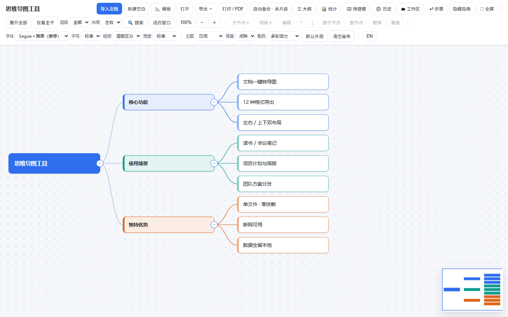
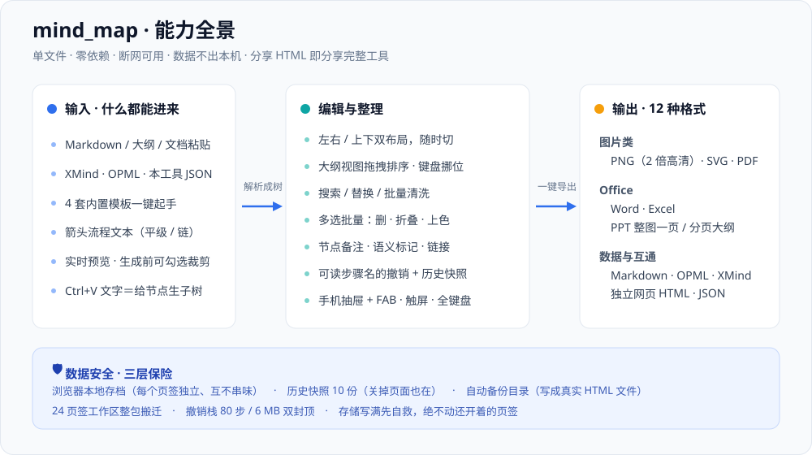
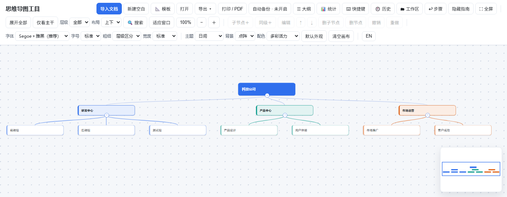
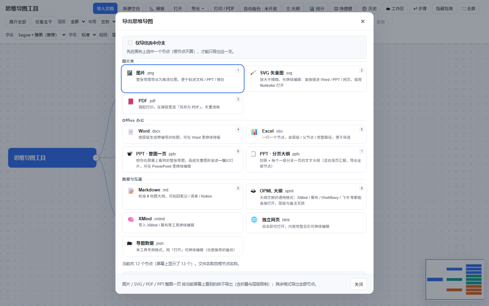
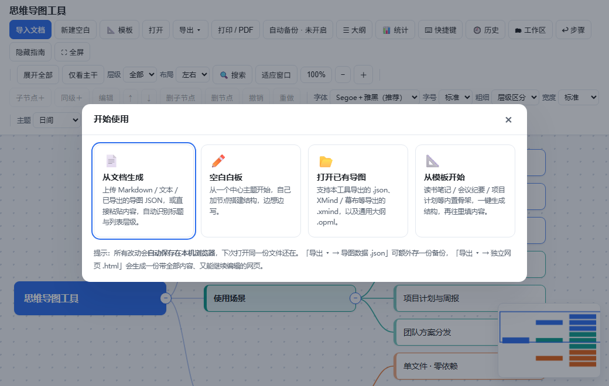

# 思维导图工具 · MindMap

**简体中文** ｜ [English](README.md)

**一个 HTML 文件，就是整套思维导图工具。双击打开，不装软件、不注册账号、不联网。**

<p align="center">
  
</p>

<p align="center">
  
  &nbsp;
  
  &nbsp;
  
  &nbsp;
  
  &nbsp;
  
  &nbsp;
  
</p>

绝大多数思维导图工具要注册账号、装客户端、按年付费，或者把你的图存在别人的服务器上。这个工具只有 **一个约 493 KB 的 HTML 文件**：双击就能用，断网照样用，图画在你自己硬盘里。

> **分享即工具**：把这个 HTML 文件发给任何人，对方双击打开，拿到的就是和你完全一样的完整工具 —— 能看、能改、能继续导出。没有安装包、没有登录、没有服务器。
>
> **在线试用**：[mindmap-tool-30044.app.workbuddy.host](https://mindmap-tool-30044.app.workbuddy.host/?sharecode=UQCAJVJB6M)（快速预览用；长期使用请下载文件本地打开，数据才真正只留在你手里）

---

## 为什么是它

不装、不连、不留、不挑 —— 四件事它都做到了：

| 特点 | 具体做法 |
| --- | --- |
| **不用安装** | 一个 HTML 文件，双击打开就是完整应用 |
| **不用联网** | 零 CDN、零框架、零外部字体，断网照用 |
| **不留痕迹** | 没有账号、没有埋点、没有云同步 |
| **不挑格式** | 常见大纲与 XMind 都能进，12 种格式能出 |

---

## 能力全景

从「已经写下的文字」到「能交付的文档」，中间要走的路它都铺好了。

<p align="center">
  
</p>

---

## 核心功能

### 输入：把已有文字变成结构

`导入文档` 或直接把文件拖进窗口。支持 `.md` `.markdown` `.txt` `.json` `.xmind` `.opml`；Word / PDF 里的内容复制粘贴即可。

能识别的结构包括：

- **Markdown 标题** `#` `##` `###`…
- **编号大纲** `1.` / `1.1.1` / `一、` / `（一）` / `第 X 章`
- **缩进与无序列表** `-` `*` `•`
- **箭头流程** 竖着写的 `A` ↓ `B` ↓ `C`，`↓` `↓↓` `→` `->` `=>` 都认，箭头自动去掉
- **表格** `| a | b |`，首列当节点、其余列当子节点

导入面板右侧有**实时预览**，而且预览就是一棵**可勾选的条目树** —— 不想要的条目取消勾选，整棵子树一起划掉并置灰，底部实时显示「已划掉 N 个」，确认生成前就知道会得到什么。

给某个节点补充内容不用整张替换：选中它，`Ctrl+V` 粘贴一段文字，就会在它下面生成子树。

### 编辑：改结构不该靠删了重加

- **拖拽改挂**：拖住节点放到另一个节点上，整棵子树搬过去（带环路检查，不会把父节点拖进自己的子孙里）
- **键盘走全流程**：`Tab` 加子节点、`Enter` 加同级、`F2` 改名、方向键在树上走、`Alt+↑↓` 调换顺序 —— 全程不摸鼠标
- **多选批量整理**：`Ctrl/⌘ + 点击` 加选、`Shift + 拖拽` 框选，一批节点一起删除 / 上色 / 折叠 / 贴标记
- **批量文本工具**：对搜索命中或选中的一批节点统一清洗 —— 加前后缀、去行首编号、去首尾空白、全半角统一、按分隔符拆分、多个节点合并成一个，整批只占一个撤销点
- **可读的撤销历史**：侧栏列出最近每一步「做了什么」（`删除「阶段二」及其 1 个下级`、`批量替换 12 处`），点任意一行直接跳过去，不用连按十几次 `Ctrl+Z`；撤掉的还能点回来
- **节点备注 / 语义标记 / 节点链接**：任意节点可以写多行说明、贴 ⭐❗❓✅🔒 标记、挂网页地址或本机文件路径 —— 三种附加信息在 12 种导出里都有对应落点，不会导出一次就丢

### 整理：图大了也找得到

图一大，真正的痛点不是「画不出来」，而是「找不到、挪不动、看不清全貌」。

- **左侧大纲视图**：点行定位、双击改名、拖一行就能排序或改挂、`Alt+↑↓` 挪位
- **右下角缩略图**：实时画整张图的全貌，点一下跳过去
- **结构统计**：层级分布、分支占比、语义标记汇总，附带「上次渲染耗时」—— 卡不卡从感觉变成可自查的数字
- **搜索定位** `Ctrl+F`：命中高亮、可只看命中分支、**搜索也管备注**、支持区分大小写 / 全词 / 正则，还能批量替换
- **两种布局**：**左右**（思维导图，默认）/ **上下**（组织结构图，汇报关系自上而下读）。切布局不改数据，方向键和折叠圆点跟着翻，导出图也按当前布局画

<p align="center">
  
</p>

### 输出：12 种格式，备注和标记一起走

`导出 ▾` 面板按用途分了**图片类 / Office 办公 / 数据与互通**三组，前 9 个格式带数字快捷键 `1`~`9`。

<p align="center">
  
</p>

| 格式 | 典型用途 | 备注怎么带 |
| --- | --- | --- |
| **PNG** / **SVG** / **PDF** | 贴文档、进 PPT、放大不模糊的矢量图 | 节点挂编号角标 + 图下方附清单 |
| **PPT · 整图一页** | 整张图以矢量图形放进一张幻灯片，可继续改色 | 形状内附小字 |
| **PPT · 分页大纲** | 封面 + 每个一级分支一页，逐页汇报 | 文字后跟小字 |
| **Word** | 按层级生成带编号标题，接着写文档 | 缩进一格的灰色小字 |
| **Excel** | 一行一节点，含层级 / 父节点 / 完整路径 | 独立「备注」列 |
| **Markdown** | 标准标题大纲，贴回笔记 / Notion | `> 备注：…` 引用块，**能再导入回来** |
| **XMind** / **OPML** | 交给 XMind / 幕布 / Workflowy / 飞书继续编辑 | 写进 `notes` / `_note` 字段 |
| **独立网页** | 双击打开、内容完整、**还能继续编辑** | 数据自带 |
| **导图数据 `.json`** | 主要备份格式，随时「打开」续编 | 数据自带 |

一句话记住范围：**图片 / SVG / PDF / PPT·整图一页** 导出「屏幕上看到的样子」；其余格式一律导出**全部节点**。

---

## 快速开始

1. 下载 `mind_map.html`，放到一个固定的文件夹
2. **双击打开**（或在浏览器里 `Ctrl+O` 选择它）
3. 首次打开是欢迎页，四条路任选

<p align="center">
  
</p>

| 入口 | 适合场景 |
| --- | --- |
| **从文档生成** | 已有笔记、大纲、会议纪要，想快速变成导图 |
| **空白白板** | 从零开始整理思路，边想边写 |
| **打开已有导图** | 继续编辑 `.json`，或打开 XMind / OPML |
| **从模板开始** | 读书笔记 / 会议纪要 / 项目计划，骨架一键生成 |

推荐 Edge / Chrome / Firefox / Safari 的较新版本。

---

## 界面语言

界面**中英双语**，右上角 `EN` / `中文` 一键切换 —— 按钮上写的是「点一下会变成什么」，不用先猜现在是哪种语言。

- **国内用户**：打开就是中文，不需要任何设置
- **国际用户**：点一下 `EN`，顶栏、菜单、右键菜单、14 个面板、全部提示语、快捷键速查表一起变成英文；导出的 Markdown / Word / Excel / PPT / 独立网页里的表头与说明文字也跟着换
- **你自己写的内容一个字都不动**：节点文字、备注、链接、你起的导图名 —— 切多少次语言都原样保留。切回中文时逐字还原（原文留在页面上，不做反向查表，所以「标准」这种一词多义不会串到别的面板去）
- 语言是**偏好**：记在本机，下次打开还是上次那个；不进导图数据、不占撤销栈，换语言不会让「撤销」凭空多一步
- 全新用户还没动过手时，中心主题也跟着语言走（「中心主题」↔「Central topic」）
- 本文件里的配图都是**中文界面**（`screenshots/*.png`）；英文 README 用的是英文界面那一套（`*.en.png`），
  这样图里的语言和你正在读的文档始终一致

---

## 手机与平板

窄屏（≤ 760px）会自动切成移动布局，不是把桌面版硬塞进小屏幕：

- 顶栏只留 **☰ + 标题**，其余功能收进**左侧滑入抽屉**（可一直滚到底，点遮罩、按 `Esc`、再点 ☰ 都能收起）
- 右下角 **FAB「＋」** 展开常用操作面板：子节点 / 同级 / 编辑 / 删子节点 / 删节点，没有物理键盘也能完整操作
- 画布接管全部手势：单指拖拽、双指缩放、长按出菜单；长按不会再弹出系统自带的「复制 / 搜索 / 翻译」条
- 抽屉和面板都是浮层，**不占用顶栏高度**，画布始终铺满

---

## 外观

改动自动记住，下次打开还是这个样子。

- **9 套主题**（日间、极简白、清新薄荷、米黄护眼、商务深蓝、水墨素雅、高级灰、夜间、午夜蓝）
- **8 套配色** · **4 种背景底纹**（纯色 / 点阵 / 网格 / 横线）
- **6 种字体方案**（英文 Segoe UI + 中文微软雅黑混排为默认）· **4 档字号** · **3 种字重**
- **5 档节点宽度**，含「自适应」（短节点收窄、长节点放宽，布局与导出同步）

想快速换风格：清新年轻 → 清新薄荷 + 糖果马卡龙；商务沉稳 → 商务深蓝 + 商务藏青；长时间看 → 米黄护眼 + 大地暖色。改乱了点「**默认外观**」一键复原，只动外观、不碰内容。

---

## 数据安全

本地工具最怕的不是崩溃，是「打开发现图没了」。所以做了三层保险：

| 层级 | 存在哪 | 防什么 |
| --- | --- | --- |
| ① **浏览器本地存档** | localStorage，按标签页分槽隔离 | 误关页面、崩溃、重启 |
| ① 附加 **历史快照** | 同一存储，最多 10 份整棵树 | 误删、改乱之后回到早先的样子 |
| ② **自动备份目录** | 你指定的 `auto_backup` 文件夹，真实 HTML 文件 | 换浏览器、清缓存、误删 |
| ③ **手动导出** | `.json` / `.html` / 其他格式 | 分享、归档、换电脑 |

几个刻意的设计：

- **多页面绝不串味**：每个标签页有独立存档槽，新开页面一律空白起步，不会显示别的页面正在编辑的图
- **备份不覆盖好数据**：节点数骤降一半以上时（清空画布、删掉大分支），不覆盖上一份备份，而是另存一份带时间戳的版本
- **撤销栈双封顶**：80 步 + 6 MB，至少保留一步，不会把浏览器内存吃干
- **存储写满会自救**：先按 7 天规则清理过期槽位，再重试写入，但绝不动当前正在用的和还开着的

---

## 技术实现

整个工具 **10258 行、约 582 KB，零外部依赖**。几个值得一提的地方：

**布局**
自实现 tidy-tree（左→右）与纵向组织图（上→下），两套共用同一份坐标语义（`x` = 节点左沿、`y` = 垂直中心），所以定位 / 边界 / 适应窗口 / 缩略图 / 框选一份代码通吃。折叠的子树不进布局计算。

**渲染**
渲染主干保持**同步**（60 多处调用点都要在 `render()` 之后立刻读结果），节流只做在高频输入那一条路上：`renderSoon()` 用 `requestAnimationFrame` 把同一帧的多次请求合并成一次。节点挂载走 `DocumentFragment`，一次建好一次插入 —— 真 Chrome 里 `MutationObserver` 数到的一次渲染 DOM 变更批次从 **1 + 607 批降到 2 批**。拖拽期间只动 `transform` 和选框，平移 10 帧期间 DOM 变更实测 **0 批**。

**文件格式**
Office 和 XMind 文件是**手写 OOXML / ZIP**（内置 store + CRC32 打包、docx / xlsx / pptx 的部件与关系、XMind 的 `content.json`）。读 `.xmind` 用的是**手写 DEFLATE 解压器**（动态 / 静态哈夫曼），不依赖任何第三方库。OPML 用浏览器原生 `DOMParser`，关键细节是属性值里的换行必须编码成 `&#10;`，否则多行备注会被 XML 规范「空白折叠」悄悄吃掉。

**一致性**
搜索的三个开关（`Aa` / 全词 / 正则）不是三套各自为政的匹配代码，而是一处 `findCompile()` 把「关键词 + 开关」编译成一个 `{test, replace}`，搜索与替换共用同一口径，不会出现「搜得到但替换按另一套规则」的漂移。非法正则降级为字面量匹配并标红输入框，不抛异常。

**质量保障**
用 jsdom 真实加载页面跑端到端交互测试，**38 套、2850 条断言**，再用真实 Chrome headless 复核布局、像素与导出产物（读缩略图 canvas 的真实像素、真的把 localStorage 写满 5 MB 验配额自救、用真实 `PointerEvent` 跑双指缩放并验算锚点、真实命中测试验证移动端抽屉不被遮罩吞掉）。导出的 docx / xlsx / pptx / xmind 用 Python `zipfile` 与 `python-pptx` 独立解包校验。

每个修复都配「反证」：临时把代码还原成旧行为，确认同一批用例**真的会变红**（23 份反证脚本，跑完用 sha1 核对还原回去的确实是原件）。另有 21 组真 Chrome 探针负责 jsdom 量不到的部分。一键回归：`python _test/runall.py`。

---

## 项目结构

```
mind_map.html            ← 全部功能在这一个文件里（双击即用）
docs/USAGE.zh-CN.md      ← 完整使用手册（中文）
docs/USAGE.md            ← 完整使用手册（English）
docs/feature-map.svg     ← 能力全景图（中文）
docs/feature-map.en.svg  ← 能力全景图（English）
docs/移动端适配改造方案.md ← 移动端改造方案与设计取舍（中文）
screenshots/             ← README 配图：*.png（中文界面）/ *.en.png（英文界面）
CHANGELOG.zh-CN.md       ← 版本记录（中文，最新在最前）
CHANGELOG.md             ← 版本记录（English）
优化分析报告.md           ← 逐版本优化分析、实测数据与落地记录
_test/                   ← 测试源码：jsdom 套件、Chrome 探针、反证脚本
_test/_artifacts/        ← 它们的运行产物（快照 / 探针页 / 导出样本 / profile），已 gitignore
.gitignore               ← 本机数据与测试产物不进仓库
```

`_test/_artifacts/` 里的东西跑测试时全都会重新生成，删掉不影响任何测试。

---

## 常见问题

**Word / PDF 能直接导入吗？**
不能直接读文件。全选复制，粘贴进导入面板的文本框即可，识别效果和 `.md` / `.txt` 一样。

**Windows 提示「你的 Internet 安全设置阻止打开这些文件」？**
那是 Windows 给「浏览器下载的文件」打的标记，跟文件本身无关。导出面板默认开启「用『另存为』对话框保存」，直接写盘的文件不带这个标记。已经下载的可以右键 → 属性 → 勾「解除锁定」。

**同时开好几个页面，内容会串吗？**
不会。每个标签页有独立存档槽，新开页面一律空白起步，各自刷新各自恢复。

**能多人协作吗？**
不能，这是纯本地单机工具。协作方式是导出 `.html` 或 `.json` 发给对方，对方用「打开」继续编辑。

**支持多大的图？**
实测 600+ 节点仍可流畅编辑。节点上千建议先折叠到 2~3 层再操作或导出。

---

**完整说明见 [docs/USAGE.zh-CN.md](docs/USAGE.zh-CN.md)** —— 包括 12 种导出格式的逐项细节、箭头流程、导入预览勾选、工作区页签、外观方案搭配、全部快捷键与更多 FAQ。
