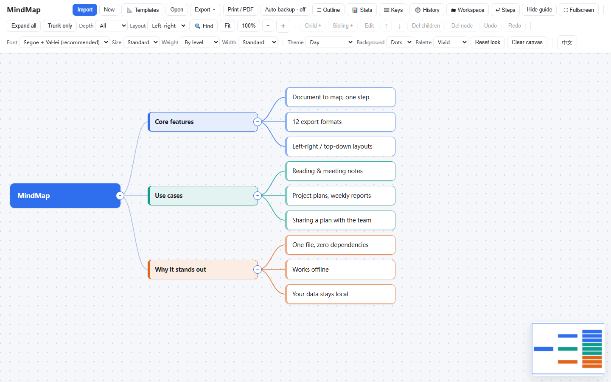
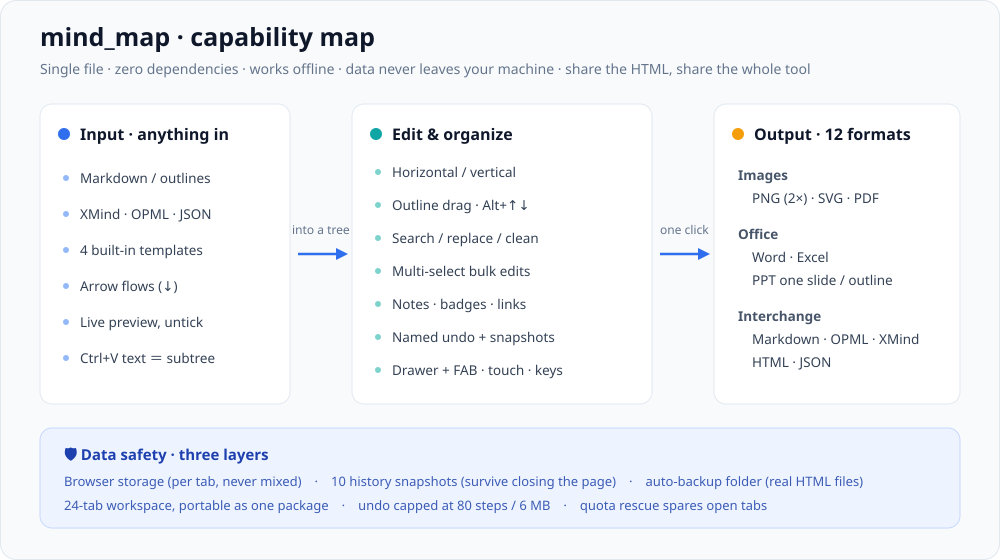
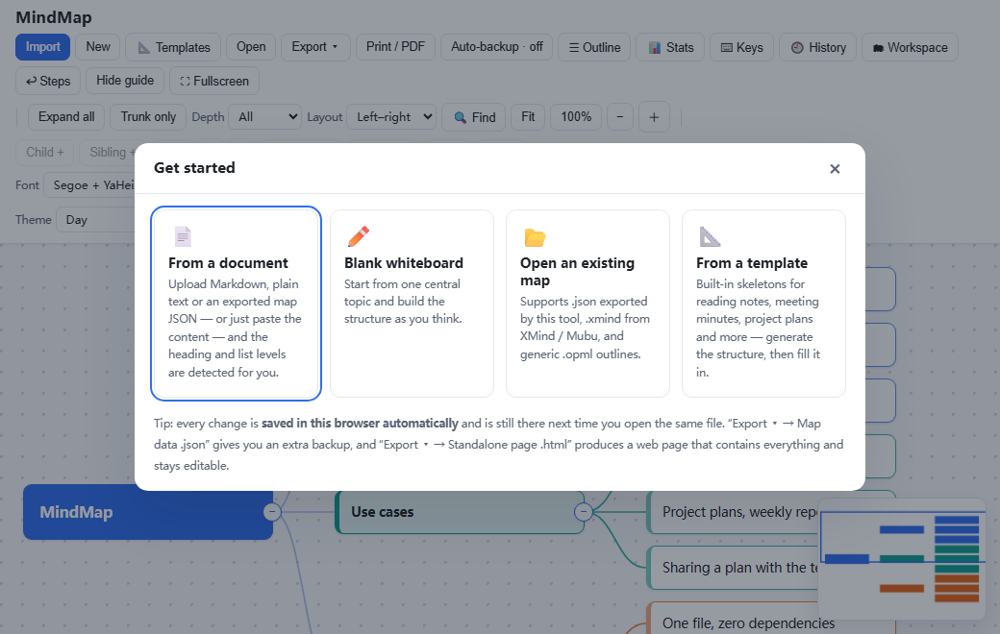
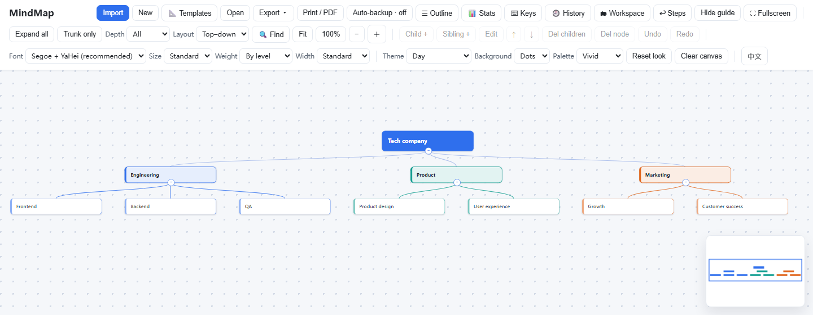
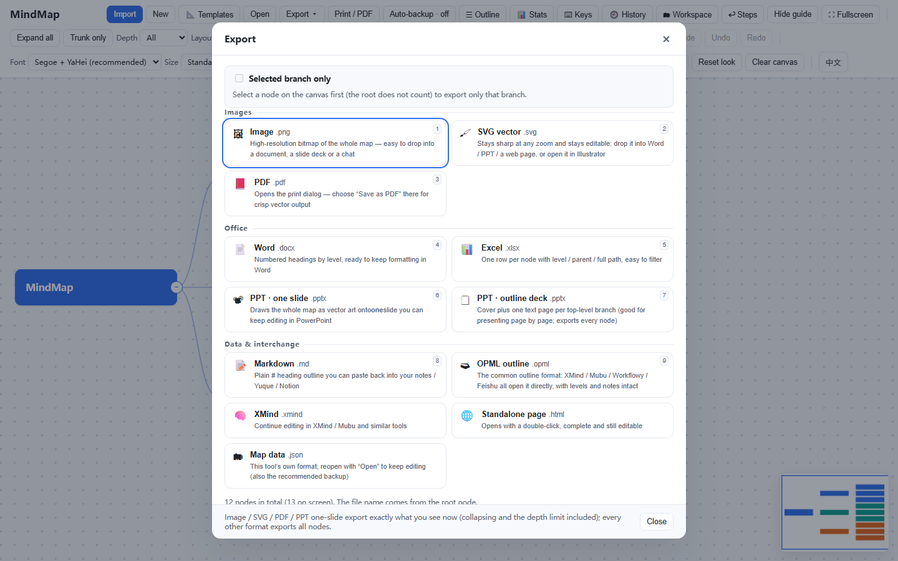

# MindMap · 思维导图工具 · User Guide

[简体中文](USAGE.zh-CN.md) ｜ **English**

> A **single-file, zero-dependency** mind-mapping tool that runs locally: open `mind_map.html` in a browser and you are done.
> No install, no network, no upload — every byte stays on your own machine.
> Project overview and download: [README](../README.md).

  

> **Sharing is the install**: send the HTML file to anyone, they double-click it and get exactly the same full tool — view, edit, export. No package, no account, no server.
>
> **🌐 Try it online**: [mindmap-tool-30044.app.workbuddy.host](https://mindmap-tool-30044.app.workbuddy.host/?sharecode=UQCAJVJB6M) (hosted demo for a quick look; for real work download `mind_map.html` and open it locally so the data stays with you)

---

## Contents

| Chapter | What it covers |
| --- | --- |
| [1 Overview](#1-overview) | The big picture, feature list |
| [2 Getting started](#2-getting-started) | Opening the file, generating from a document, templates, opening existing maps |
| [3 Editing](#3-editing) | Node operations, multi-select, drag-to-reparent, fold/level, notes, badges, links |
| [4 Finding & organizing](#4-finding--organizing) | Search, replace, text cleanup, outline view, statistics |
| [5 View & navigation](#5-view--navigation) | Pan/zoom, two layouts, full screen, minimap, hint box |
| [6 Appearance](#6-appearance) | Fonts, sizes, themes, palettes, backgrounds, **interface language** |
| [7 Export](#7-export) | 12 formats, how notes and links travel, the PPT trade-off |
| [8 Saving & recovery](#8-saving--recovery) | Three layers of safety, per-tab isolation, snapshots, workspace, auto backup |
| [9 Keyboard & touch](#9-keyboard--touch) | Shortcuts, keyboard-only flow, touch gestures, phones |
| [10 FAQ](#10-faq) | Import / export / saving / usage |
| [11 Implementation notes](#11-implementation-notes) | Layout, rendering, file formats, quality assurance |

---

## 1 Overview

### 1.1 The big picture

From "text I already wrote" to "a document I can hand over" — every step in between is covered:

  

A one-line test for whether this tool fits: **is your task "turn a pile of text into something structured, then hand it over"?** If yes, it covers the whole path.

### 1.2 Feature list

**Input — turn existing text into structure**

- Markdown, plain-text outlines, XMind, OPML and this tool's own JSON; Word and PDF work by copy-paste
- The import preview is a **checkable item tree** — untick what you don't want before anything is created
- Vertical **arrow flows** (`A ↓ B ↓ C`) drop the arrows automatically, optionally chained
- Select a node and press `Ctrl+V` with text on the clipboard to grow a subtree under it

**Editing — restructure without delete-and-retype**

- Drag a node onto another node to move the whole subtree (with cycle checks)
- `Tab` child, `Enter` sibling, `F2` rename, arrow keys to walk, `Alt+↑↓` to reorder — no mouse needed
- Multi-select to delete / colour / fold / badge in bulk; rubber-band selection
- Batch text cleanup: add prefix/suffix, strip leading numbering, full-width ↔ half-width, split by delimiter, merge nodes
- Undo history with human-readable step names — click a row to jump there

**Attachments — notes, badges, links**

- Any node can carry a multi-line note, a semantic badge (⭐❗❓✅🔒), and a URL or local path
- All three survive every one of the 12 export formats

**Finding & organizing — usable at scale**

- `Ctrl+F` search (covers notes, case sensitivity, whole word, regex) plus batch replace
- Outline sidebar: click to locate, double-click to rename, drag to reorder or re-parent
- Minimap in the corner
- Statistics: level distribution, branch share, badge summary, last render time

**View — one dataset, several readings**

- Horizontal (mind map) / vertical (org chart) layouts; switching changes no data
- Immersive full screen that also hides the toolbar
- 6 font stacks × 4 sizes × 3 weights × 5 node widths × 9 themes × 8 palettes × 4 backgrounds

**Output & safety — hand it over, keep it around**

- 12 export formats (images / Office / interchange), notes and links included
- Three layers of data safety: browser storage + history snapshots + auto-backup folder
- Workspace with up to 24 tabs, portable as a single package

---

## 2 Getting started

### 2.1 Open the file and meet the welcome screen

1. Put `mind_map.html` in a fixed folder (not the Downloads folder, so you can find it later).
2. **Double-click it**, or press `Ctrl+O` in a browser and pick the file.
3. The first screen is the welcome page with four ways in:

| Entry | When to use it |
| --- | --- |
| **From a document** | You already have notes, an outline or meeting minutes and want a map fast |
| **Blank canvas** | You think by writing and want to structure as you go |
| **Open an existing map** | Continue a saved `.json`, or open XMind `.xmind` / OPML outlines |
| **Start from a template** | You don't know the skeleton yet — reading notes, meeting minutes, project plan |

  

Recommended browsers: recent versions of Edge, Chrome, Firefox, Safari.

### 2.2 From a document

This is the most used entry. Click **Import document** in the toolbar, or drop a file onto the window.

**Accepted input**

- Files: `.md` `.markdown` `.txt` `.json` (exported by this tool), `.xmind` (XMind export), `.opml` (outlines from XMind / Mubu / Workflowy / Feishu)
- Paste: copy text from Word / PDF / a web page into the paste box (those formats can't be read as files; copy-paste is faster anyway)

**Structures it recognizes**

- Markdown headings: `#` `##` `###` …
- Numbered outlines: `1.` `1.1` `1.1.1`, `一、` `（一）`, `第 X 章`
- Indentation and bullets: `-` `*` `•`
- **Arrow flows**: vertical `A` / `↓` / `B` / `↓` / `C` (see [2.2.1](#221-arrow-flows))
- **Tables**: `| a | b |` — first column becomes the node, the rest become children (`column: value`)

**Generation options**

| Option | Meaning |
| --- | --- |
| Root node | Leave empty to use the file name as the central topic |
| Max depth | 4 levels by default; for long documents use 2–3 so detail doesn't swamp the map |
| Keep original numbering | On by default — keeps things like `1.1` |
| Include list items | **Off** by default (headings only). Turning it on takes body text too, and the node count explodes |
| ↓ Chain arrow flow | **Off** by default (＝strip arrows, steps stay siblings). On ＝ the step after an arrow becomes a child of the step before. **The choice is remembered** and also applies to paste |

Generation replaces the current canvas; `Ctrl+Z` brings the previous map back in one step.

**The preview is a checkable item tree**: every item has a checkbox, unticking one greys out its entire subtree, the footer shows "N items excluded", and the confirm button's state tracks the number of nodes that will actually be created. There is also "select all / none". The central topic row can't be unticked. Change the input and the ticks reset.

**Just want to add to one node?** Select it and press `Ctrl+V` with text on the clipboard — a subtree grows under it instead of replacing anything. The same structures are recognized, and `name: description` lines split into two levels. `Ctrl+Z` undoes it.

> **Notes round-trip**: Markdown exported by this tool writes notes as `> 备注：…` blockquotes, and **re-importing reads them back onto the nodes** — so "export .md → edit → import" never loses notes.

#### 2.2.1 Arrow flows

Flow charts, agent execution traces and pipeline steps are usually written as a single column of lines:

    default (off)                     with "↓ Chain arrow flow"
    User                            User
    ↓                               └─ LLM
    LLM                                └─ Tool Call
    ↓                                   └─ Tool
    Tool Call                              └─ Tool Result
    ↓                                         └─ LLM
    Tool                                           └─ Final Answer
    ↓
    Tool Result
    ↓
    LLM
    ↓
    Final Answer

- **Arrow-only lines are dropped**: `↓ ⇓ ⬇ → ⇒ ➜ ➡ ⟶` and ASCII `->` `-->` `=>` `==>`, including repeats like `↓↓↓`. Lines carrying markers such as `- ↓` or `1. ↓` count too. Only a line that is *nothing but* arrows qualifies — "temperature ↓" or "A → B" inside a line are node names and stay intact.
- **Siblings by default**: after the arrows are stripped, the steps are siblings.
- **Chaining is opt-in**: with "↓ Chain arrow flow" ticked, each arrow makes the following step a child of the previous one.
- **The choice sticks**: tick it once in the import panel and paste follows it too (default: siblings).
- **Headings are not overruled**: `# A ↓ # B` stays two sibling headings (`#` count wins).
- Arrows inside tables, code blocks and notes are never touched.

### 2.3 From a template

When you don't know how to shape the structure, start from a ready-made skeleton: **Templates** in the toolbar (also on the welcome page).

| Template | Contents |
| --- | --- |
| **Blank** | Just a central topic |
| **Reading notes** | Basics / key points / chapter thread / quotes / my thoughts / action list |
| **Meeting minutes** | Meeting info / agenda / decisions / action items / open questions |
| **Project plan** | Background & goals / scope / milestones / responsibilities / risks / deliverables |

Each card shows an icon, a description and a **preview of the first two levels**, so you know what you get before choosing. One click creates it:

- If the canvas already has content, a confirmation dialog appears first (with a one-click backup option) — nothing is overwritten silently;
- The whole template is **one undo step**;
- Depth filter resets to "all" and stale search filters are cleared, so the new skeleton is fully visible.

### 2.4 Open an existing map

Click **Open**, or drop a file onto the window:

| File type | What happens |
| --- | --- |
| `.json` (this tool) | Everything returns: nodes, notes, badges, links, fold state, appearance preferences |
| `.xmind` | Read as an editable tree (notes included) |
| `.opml` | Outline read as a tree (notes from `_note` included) |
| `.html` (standalone page) | Opening it is the tool itself; to merge into the current canvas, use its "export .json" and import that |

When the canvas already has content, a confirmation dialog offers three buttons: **back up as .json and continue**, **back up as web page and continue**, **continue without backup**.

---

## 3 Editing

### 3.1 Basic node operations

Click a node to select it (it highlights), then:

| What you want | Toolbar | Shortcut | Notes |
| --- | --- | --- | --- |
| Add child | Child + | `Tab` | One level below the current node |
| Add sibling | Sibling + | `Enter` | Same level as the current node |
| Edit text | Edit / double-click | `F2` | `Enter` saves, `Esc` cancels |
| Move up / down | ↑ ↓ | `Alt+↑` `Alt+↓` | Reorder among siblings |
| Delete node | Delete node | `Delete` | Subtree goes with it (confirmation first; the root can't be deleted) |
| Delete all children | Delete children | `Shift+Delete` | Confirmation first; **keeps** the node and clears everything below |
| Move a whole subtree | — | drag with the left button | Drop onto another node (see [3.4](#34-drag-to-reparent)) |
| Undo | Undo | `Ctrl+Z` | Covers delete, generate, clear and drag-reparent |
| Redo | Redo | `Ctrl+Y` / `Ctrl+Shift+Z` | Anything new invalidates the redo history |
| Copy subtree | Context menu | `Ctrl+C` | Whole subtree, also written to the system clipboard |
| Paste subtree / paste text | Context menu | `Ctrl+V` | **Decided automatically**: copied subtree → paste as is; plain text → parsed into a subtree under the selection |
| Clone in place | Context menu | `Ctrl+D` | Duplicate right after the sibling position (with subtree) |
| Walk the tree | — | `↑↓←→` | `↑↓` move within a level (cousins included, wraps around), `←` parent, `→` first child; `Home` / `End` first / last in the level |
| Fold / unfold | Circle on the node | `Space` | Toggles the selection (applies to a whole multi-selection) |
| Write a note | Context menu → Edit note | `Ctrl+Shift+M` | See [3.6](#36-notes) |
| Semantic badge | Context menu → Badge | — | See [3.7](#37-semantic-badges) |
| Node link | Context menu → Edit link | `Ctrl+Shift+L` | See [3.8](#38-node-links) |
| Copy as text / Markdown | Context menu | `Ctrl+Shift+C` | Indented plain text or `#` heading levels |
| Per-node colour | Context menu 🎨 | — | Colours the node and all its descendants (border, fill, edges) |
| Context menu | — | Right-click | Everything above is also on the right-click menu |

### 3.2 Typing without interruption

To add a run of nodes, don't reach for the mouse:

1. Select a node → `Tab` adds a child → type
2. Inside the editor, `Tab` again ＝ **save this one and create its child**
3. `Enter` saves and ends editing; to add siblings, go back to the canvas and press `Enter`

Guarantees:

- Once editing starts, the caret stays in the editor until you press `Enter` (save), `Esc` (cancel) or click elsewhere.
- Background tasks (auto backup, local storage, relayout) only **read** what you are typing; they never pull the editor away, and a half-typed word is never committed behind your back.
- `Shift+Enter` inserts a line break (plain `Enter` saves).

### 3.3 Multi-select and bulk operations

| Action | How |
| --- | --- |
| Add / remove | `Ctrl` (`⌘` on macOS) + click a node; click again to remove |
| Extend | `Shift` + click |
| **Rubber band** | Hold `Shift` (or `Ctrl`) and drag on empty canvas (a plain drag still pans) |
| Bulk delete | Select, then `Delete` (only outermost nodes are processed; one `Ctrl+Z` restores the batch) |
| Bulk fold / unfold | Select, then `Space` |
| Bulk colour / badge | The colour and badge buttons in the context menu |

The primary node gets a solid selection box, the rest get blue rings; the lower-left corner reports "N selected (M including descendants)".

### 3.4 Drag to reparent

No need to delete and retype: **hold the left button and drop node A onto node B** — A and all its descendants move under B.

- A tooltip follows the cursor ("attach under『XX』") and the target gets a highlighted outline.
- Dropping on the **central topic** promotes the node to a top-level branch; dropping back on the **original parent** moves it to the end of that level (useful for reordering).
- Three cases are refused with a message: the **root** can't be dragged, dropping onto **itself** does nothing, and dropping into **its own descendants** would create a cycle (the tooltip turns red).
- Movement beyond 5 px is required to start a drag, so click-to-select and double-click-to-edit are unaffected. `Ctrl+Z` undoes it.

> Dragging on a zoomed-out canvas is fiddly — **the outline sidebar (`☰`) also supports drag reorder / reparent**, plus `Alt+↑↓` to nudge within a level (see [4.4](#44-outline-view)).

### 3.5 Folding, unfolding and depth

- The **small circle** on the right edge is the fold toggle: `−` expanded (click to collapse), `+` collapsed (solid, click to expand). Manual fold state is **saved in the file** and survives level changes and reloads.
- **Expand all**: opens every level (depth returns to "all", manual folds released).
- **Trunk only**: same as depth = 1 level — central topic plus first-level branches.
- **Depth dropdown**: show only the first 1–6 levels. Cut branches appear as **dashed circles** with a `+N` badge (N ＝ hidden descendants). Clicking `+` on one branch expands **only that branch**; the rest stay at the chosen depth. Truncated nodes don't draw outgoing edges, so the picture stays tidy.
- Depth and "trunk only / expand all" are **one state**: trunk ＝ 1 level, expand all ＝ all. Depth only affects the view, never the data, and manual folds are not lost when the depth changes.

### 3.6 Notes

**Right-click → Edit note** (or `Ctrl+Shift+M`) writes a multi-line note on the node — acceptance criteria, a link, background for a TODO.

- Nodes with a note get a **small badge in the top-right corner**; hover shows the full text, and the matching outline row gets a pencil icon.
- The badge is **absolutely positioned** and takes no internal space — column widths, node sizes and edge positions are unchanged.
- In the dialog `Ctrl+Enter` saves, `Esc` cancels, **saving an empty note deletes it**, and `Ctrl+Z` undoes.
- Notes are stored and exported with the map (see [7.3](#73-where-notes-badges-and-links-land)).
- This is the place for explanation that shouldn't pollute the node text.

### 3.7 Semantic badges

A note is "a paragraph of text"; a badge is "an icon you see at a glance". The context menu has a row of **badge** buttons with five built-ins:

| Badge | Meaning |
| --- | --- |
| ⭐ | Key point |
| ❗ | Risk |
| ❓ | Open question |
| ✅ | Done |
| 🔒 | Final |

- Badges are drawn in the **top-left** corner — the three corners (badge top-left, note number top-right, truncation marker bottom-left) never collide.
- **Bulk applies to a whole selection** (outermost nodes only, so a subtree isn't processed twice); when the whole selection already carries the same badge, clicking again **clears** it.
- Absolutely positioned, so node size and edges don't change by a single pixel.
- In the outline, badges come **before** the text, so risky rows are visible at a glance.
- **📊 Statistics** gains a "badges" section that answers "how many risks are in this map".
- Nodes without badges write no field and draw no marker, so old files round-trip unchanged. `Ctrl+Z` undoes a mis-click.

### 3.8 Node links

In research notes, reading notes and project lists a node often needs to point at external material — a web page, a local PDF, a shared folder. Writing the address into the node text (ugly) or a note (invisible) used to be the only option; now there is a dedicated field:

| What | How |
| --- | --- |
| Attach | Select the node → right-click → Edit link, or `Ctrl+Shift+L` |
| Open | Click the chain badge in the top-right corner, or **`Alt` + click** the node |
| Change / clear | Same dialog; **save empty ＝ clear** |
| See what has one | The outline row also shows a chain icon; **📊 Statistics** counts "N nodes with links" |

**`Ctrl` + click is still "add to selection"** — opening a link deliberately uses `Alt`, so the two never fight.

**URLs and local paths behave differently** (a browser restriction, not laziness):

| What you attached | What a click does |
| --- | --- |
| `https://…` / `http://…` / mail / phone | **Opens in a new tab** |
| `D:\docs\x.pdf` / `/Users/a/b.md` / relative path | **Copies to the clipboard** and tells you to paste it into Explorer / Finder |

Browsers **do not allow** a page to open `file://` or local paths — a hard jump fails silently. So the tool copies the path and explains why, instead of pretending it worked.

**Dangerous schemes are rejected**: `javascript:` / `data:` can't be stored, can't be opened, and never appear in any export — the exported standalone HTML is meant to be double-clicked by someone else, and a `javascript:` link would be a ready-made XSS.

### 3.9 Long text and node width

Node text shows up to 4 lines. **When it is truncated a `⋯` marker appears in the bottom-left corner** (it used to vanish silently), hover shows the whole text, and double-clicking opens the editor with everything.

To show more: increase the node width in the toolbar, or pick **Auto** — short nodes tighten up, long ones grow to 420 px, and the layout follows the measured width.

---

## 4 Finding & organizing

### 4.1 Search

Click **🔍 Search** or press `Ctrl+F`:

- Search-as-you-type; matches get an **orange outline** and the rest fades back;
- The bar shows "n of m"; `Enter` / `↓` next, `Shift+Enter` / `↑` previous, wrapping around;
- Jumping **auto-expands collapsed parents**, releases the depth filter and pans to the match;
- Tick **Only matches**: branches without a match collapse (dashed circle + `+N`), leaving only the matching paths;
- `Esc` or the × closes the bar and clears the highlights.

**Notes are searched too.** Nodes matched only in their note get a **teal dashed frame** (title matches are orange solid), and the counter adds "· notes N" so you know these matched in the note rather than the title.

**Three match switches** (right of the search box):

| Switch | Effect | When to use |
| --- | --- | --- |
| **Aa** case sensitive | Off by default, so `apple` finds `Apple`; on means exact case | Find `API` but not `api` |
| **Whole word** | No letter / digit / underscore may follow | Find `apple` but not `pineapple` |
| **.*** regex | Treat input as a regular expression, groups supported | Clean dirty data, e.g. `^[0-9]+\. *` to strip leading numbers |

Each switch toggles with one click and **immediately re-runs the search** with the new rule. With regex on, "whole word" greys out (write `\b` instead), so you never get a button that does nothing.

**Typed a broken regex?** No crash, no error dialog: the input turns red, a line says "invalid regex, searched as plain text", and the search **falls back to literal matching**. Fix it and the red disappears.

### 4.2 Batch replace

When dozens of nodes need the same rename (a prefix that came in with the import, a term spelled wrong), the search bar has a **"Replace with…"** field; fill it and hit replace to update **every current match**.

- **Replacement follows exactly the same rules as the search** — `Aa` respects case, whole word respects boundaries, regex allows `$1` group references;
- **Titles only, never notes.** Nodes that matched in their note are left alone (the tool tells you "all matches were in notes");
- One undo step for the whole batch;
- Matches are recomputed afterwards, so you see the result immediately. No search, no replace — nothing else is touched.

### 4.3 Batch text cleanup (🧹 Batch)

Cleaning up imported data is the painful part. The **🧹 Batch** button in the search bar opens a panel with **two scopes** (both counts are shown live):

- **Search matches** — run a search first, then process that set;
- **Canvas selection** — pick nodes with `Ctrl` / `Shift` first.

Four groups of operations:

| Group | Operation | Notes |
| --- | --- | --- |
| Affix | Add prefix / add suffix | One input and one button each; applies the same text to the whole set |
| Clean | Strip leading numbering / trim spaces / full-width→half-width / half-width→full-width | For titles pasted from Word or the web with numbering and full-width punctuation |
| Split | Split into children by delimiter | Enter a delimiter (e.g. `、`) to split **the selected node** into several children. **Non-destructive**: the node text stays, the pieces become children |
| Merge | Merge the selected nodes into one | The first node in canvas order becomes the result and adopts the others **and their children**; the separator is configurable (default ` / `) |

Worth knowing:

- **One undo step for the whole batch**;
- **Titles only, never notes** — same rule as search and replace;
- If nothing needs changing, **nothing is written to the undo stack**, just "none of these N nodes could be cleaned", so repeated clicks don't flood it;
- **Leading-number stripping recognizes** `- * + •`, `1. / 1.1 / (2) / 一、/ 第一章`; a number must be followed by a separator, so "2024 年会" is not cut down to "年会";
- Multi-level numbering `1.1` and decimals like `3.14` are indistinguishable, so they are treated as numbering — `Ctrl+Z` brings it back;
- `Esc` closes the panel, `Enter` triggers the action belonging to the focused input.

### 4.4 Outline view

**☰ Outline** in the toolbar opens a left sidebar listing the whole tree with indentation, fold triangles and item counts.

- **Click a row** → the canvas jumps to that node (collapsed ancestors expand; a search filter or depth limit blocking the way is released so you really see it).
- **Double-click the text** → rename in place.
- **Drag a row** → reorder or reparent right in the sidebar, no zooming needed:
  - Drop on the **top / bottom edge** of a row (the outer 28% on each side) ＝ place before / after it, with an accent line showing the landing spot;
  - Drop in the **middle** of a row ＝ become its child, with an outlined, translucent row;
  - Dropping on **its own descendant** is refused, the row turns **red** and the reason is shown;
  - Dropping into a collapsed node expands it; the source row fades while dragging.
- **`Alt+↑` / `Alt+↓`** move the row within its level (same action as on the canvas).
- The fold triangle only changes structure, it never moves the view; `Esc`, the × in the corner and the toolbar button all close the sidebar; the canvas shifts right to make room.
- A wrong drop is a `Ctrl+Z` away.

### 4.5 Statistics

**📊 Statistics** shows: node count, max depth, leaves, collapsed count, **nodes per level**, **share per top-level branch** (same colours as the canvas), and a **badge summary** ("⭐ key 2　❗ risk 3").

There is also a **Render** section: last render duration in ms, cumulative render count, nodes currently displayed. With 400+ nodes and a last render over 60 ms, it adds an **actionable hint** — "collapse branches you don't need, or cap the depth" — instead of just saying "slow".

Statistics describe the **whole map**, independent of folding and depth; the panel refreshes live while you edit.

---
## 5 View & navigation

### 5.1 Canvas navigation

| Action | How |
| --- | --- |
| Pan | Hold the left button on empty canvas and drag |
| Zoom | `Ctrl` / `⌘` + wheel (anchored at the cursor), or the ＋ / − buttons |
| Scroll | Wheel scrolls vertically; `Shift` + wheel scrolls horizontally |
| Fit to window | Scales until everything fits; **never below 75%**, so text stays readable |
| 100% | Back to natural size |
| Clear selection | Click empty canvas |

### 5.2 Layouts: horizontal and vertical

Next to the depth control there is a **Layout** dropdown with two options:

| Option | Shape | When to use |
| --- | --- | --- |
| **Horizontal** (default) | Central topic on the left, branches growing right | Brainstorming, reading notes, requirement breakdown — when you want it to grow outward |
| **Vertical** | Central topic on top, levels stacked downward, siblings side by side | Reporting lines, org charts, WBS, family trees — when it should be read top-down |

  

Details:

- **Switching changes no data**: the same map seen from another direction — text, notes, badges and order stay as they were, and no "layout change" entry appears in undo.
- **Arrow keys follow the layout**: horizontal is `←` parent, `→` first child, `↑↓` within the level; vertical is `↑` parent, `↓` first child, `←→` within the level. Otherwise your fingers and the picture disagree.
- **Fold circles move too**: on the right edge in horizontal layout ("more to the right"), at the bottom centre in vertical layout ("more below"). The 26 px touch target still applies.
- **Exports follow**: PNG / SVG / PDF / PPT draw nodes and edges in the current layout — what you see is what you get.
- **Remembered**: stored with the theme and palette, restored on reload and carried into exported standalone HTML.
- Switching fits the view to the window once.

### 5.3 Immersive full screen

Click **⛶ Full screen**, or press `F` / `F11`. The **toolbar hides as well** and the canvas fills the screen — good for presenting, screenshots, or thinking quietly.

To reach the toolbar without leaving full screen:

- **Move the mouse to the very top edge** (within 8 px) and the toolbar slides down; it retracts when you move away;
- A translucent **⛶ exit** button stays in the top-right corner (it becomes solid on hover);
- `Esc` / `F` / `F11` leaves full screen and restores the normal view.

If the environment forbids the Fullscreen API (embedded previews, for example), it degrades to an **immersive mode**: no Fullscreen API call, but the toolbar still hides and the canvas still goes edge to edge, with the same ways out.

### 5.4 Minimap

With enough nodes (8+), a **minimap of the whole map** appears in the bottom-right corner, with a rectangle showing the current viewport:

- **Click** → the viewport jumps there;
- **Drag** → continuous navigation, like dragging a map;
- Few nodes → no minimap, no wasted space.

### 5.5 The hint box

The lower-left box (shortcut digest plus selection info) can be tucked away:

- Click the **×** on the box, or **Hide guide** in the toolbar → it collapses into a small `?` dot.
- With it collapsed, **hover the `?`** and the guide expands; move away and it retracts.
- To pin it, click the `?` or the toolbar button again.
- The collapsed state is remembered and carried into exported standalone HTML.

---

## 6 Appearance

The rightmost toolbar group; changes are **remembered automatically**.

### 6.1 Fonts, sizes, weights, widths

**Fonts (6 stacks, each visibly different on Windows)**

| Stack | Character |
| --- | --- |
| **Segoe + YaHei** (default, recommended) | Segoe UI for Latin (crisp at small sizes), Microsoft YaHei for Chinese (tuned for screens / ClearType). The same stack is used in PNG, Word and PPT exports |
| Microsoft YaHei | Uniform look, most "solid" |
| DengXian | Lighter and tighter than YaHei, airier with many nodes |
| SimHei | Heaviest and most eye-catching — good for projectors and screenshots |
| SimSun (serif) | Formal / print-oriented |
| System default | No Chinese font specified; the browser decides |

> The old "Microsoft YaHei UI" option rendered pixel-identically to "Microsoft YaHei" in Chrome and was removed; every option now makes a visible difference.

**Sizes (4)**: small / standard / large / extra large. Every node except the root uses the same size (the old mix of 13 px and 13.5 px read as sloppiness rather than hierarchy); the root is one step larger.

**Weights (3)**: by level (default: root and branches bold, leaves regular) / all regular / all bold.

**Widths (5)**: narrow / standard (default) / wide / extra wide / **auto**. Auto tightens short nodes and grows long ones up to 420 px; layout columns follow the measured width, and PNG / PPT exports use the same width.

### 6.2 Themes, palettes, backgrounds

- **Themes (9)**: Day, Minimal white, Fresh mint, Warm paper, Business navy, Ink wash, Premium grey, Night, Midnight blue
- **Palettes (8)**: Vivid, Candy macaron, Natural green, Ocean blue, Corporate navy, Morandi, Earth warm, Quiet grey
- **Backgrounds (4)**: solid, dots, grid, ruled lines

**The root node and the toolbar follow the theme**: under Day the root is `#2f6fed` and the toolbar is white; themes such as Business navy are dark by design. If they look "black", the theme was probably switched by accident (rolling the wheel while the dropdown still had focus used to do that — it now releases focus after selection). If it already happened, **Reset appearance** restores it.

### 6.3 Reset and suggested combinations

**Reset appearance** puts theme / palette / background back to the factory look (Day + Vivid + dots) without touching content.

| Mood | Combination |
| --- | --- |
| Young and fresh | Fresh mint / Minimal white + Natural green or Candy macaron + dots |
| Business, composed | Business navy / Premium grey + Corporate navy or Morandi + solid |
| Long sessions, easy on the eyes | Warm paper + Earth warm |
| Writing at night | Midnight blue / Night (node borders lighten automatically) |

### 6.4 About font weights

Weights follow the level by default: the root and branches are **bold**, leaves are **regular** — a deliberate visual hierarchy. Pick **all regular** or **all bold** to make the whole map uniform.

Early versions also had "fake bold": intermediate weights such as `font-weight:650/600`, while Microsoft YaHei only ships **regular (400) and bold (700)**. The browser synthesized the rest, which looked blurry and inconsistent. Everything is now 400 / 700 only.

---

### 6.5 Interface language: Chinese / English

The `EN` / `中文` button at the far right of the toolbar switches the whole interface with one click. **The label shows what you will get**: when it reads `EN` you are in Chinese and a click takes you to English, and vice versa. That is the Gmail / GitHub convention, and it saves you one guess about the current state.

| Switches | Stays put |
| --- | --- |
| Toolbar buttons, dropdown options, context menu | Node text on the canvas |
| Titles, descriptions and buttons of all 14 panels | Node notes and node links |
| Every toast (including undo step names) | Map names and file names you chose |
| Every line of the shortcut cheat sheet | Text you pasted or imported |
| Table headers and captions inside exports | — |

Details worth knowing:

- **Switching back to Chinese is a byte-for-byte restore**, not a second translation. The original is kept on the DOM the first time a label is translated and simply put back — so an ambiguous word (Chinese `标准` is both a size and a width) can never drift into the wrong panel after a round trip.
- **Language is a preference, not data.** It lives in the same local settings as the theme and palette, never goes into the map data, and never pushes an undo step. Changing language will not add a phantom `Ctrl+Z`.
- **A brand-new map** follows the language too (`中心主题` ↔ `Central topic`) — but only while you have not touched anything (empty undo stack). Once you have edited anything, node text counts as your content and is left alone.
- **English is slightly wider**: the context menu measures 311 px in Chinese and 348 px in English (+12%). The toolbar does not overflow horizontally and no button label gets clipped — both are checked by real-Chrome measurements.
- **This guide is illustrated in the language you are reading.** The pictures here, like the ones in [`README.md`](../README.md), are captured with the UI set to English (`screenshots/*.en.png`); [`USAGE.zh-CN.md`](USAGE.zh-CN.md) uses the Chinese set (`screenshots/*.png`). Nothing in the tool changes — only which set of screenshots a document points at.

---

## 7 Export

### 7.1 The panel and its shortcuts

Click **Export ▾**. Formats are **grouped by purpose** (Images / Office / Data & interchange), two per column, which is faster to scan than a single long list. **The first nine have number shortcuts**: with the panel open, press `1`–`9`; `Esc` closes it. The format you used last gets a "last used" tag.

  

- **Only one branch?** Tick **Export selection only** and all 12 formats emit just the selected node and its subtree (the tick does not clear itself — remember to untick it).
- Export goes through the system **Save As** dialog by default, so files written this way are **not** tagged "from the Internet" by Windows (see the [FAQ](#10-faq)). Untick the option at the bottom of the panel to go back to plain downloads.

### 7.2 The 12 formats

| Format | Use it for | Scope | How notes travel |
| --- | --- | --- | --- |
| **PPT · one slide** `.pptx` | The map as **vector shapes on a single slide**, editable in PowerPoint | What you see | An extra grey line inside the shape (omitted when the text would overflow) |
| **PPT · paged outline** `.pptx` | Cover + one page per top-level branch, for presenting page by page | All nodes | A small grey line after the node; top-level notes included |
| **Word** `.docx` | Numbered headings by level, ready to keep writing | All nodes | A grey italic paragraph one level in |
| **Excel** `.xlsx` | One row per node with level / parent / full path, easy to filter | All nodes | A dedicated "Note" column |
| **XMind** `.xmind` | Continue editing in XMind, Mubu, etc. | All nodes | The topic's `notes` field (readable back) |
| **OPML outline** `.opml` | The lingua franca of outlines: XMind / Mubu / Workflowy / Feishu all open it, and it imports back | All nodes | The `_note` attribute (line breaks encoded correctly) |
| **Markdown** `.md` | A standard `#` outline for notes apps | All nodes | A `> 备注：…` blockquote (**re-imports onto the node**) |
| **Image** `.png` | 2× bitmap for documents, slides, chat | What you see | Numbered badges plus a note list below the map |
| **SVG** `.svg` | Sharp at any size, drops into Word / PPT / web, editable in Illustrator | What you see | Same as PNG |
| **PDF** `.pdf` | Print → save as PDF, vector-crisp | What you see | A note list appended at the end |
| **Standalone page** `.html` | Double-click to open, complete **and still editable** — the best way to share | All nodes | Included in the data |
| **Map data** `.json` | This tool's own format; open it later to continue; the main backup format | All nodes | Included in the data |

> One line to remember: **PNG / SVG / PDF / PPT·one slide** export "what you see on screen" (folds and depth included); everything else exports **all nodes**.

### 7.3 Where notes, badges and links land

| Format | Notes | Badges | Links |
| --- | --- | --- | --- |
| JSON / standalone HTML | Included | Included | Included |
| Markdown / copy as Markdown | `> 备注：…` blockquote, re-importable | Icon before the node text | Real link `[text](https://…)`; local paths become a `> 链接：…` footnote |
| Word | Grey text one level in | Icon before the heading | Real hyperlink (`w:hyperlink` + external relationship) |
| Excel | Dedicated column | Icon in the node name | An extra "Link" column |
| PPT · paged outline | Small grey line after the node | Icon before the text | A blue line below the node |
| PPT · one slide | Small text inside the shape | Icon + space before the text | 🔗 before the text |
| XMind / OPML | `notes` / `_note` | Icon in the node name | `href` / `_link` |
| PNG / SVG | Numbered badge + list below | Rounded white square with the icon, top-left | The same chain badge, top-right |
| Print / PDF | Note list at the end | Icon before the text | A link list printed on paper |

### 7.4 The "PPT · one slide" trade-off

A 16:9 slide only holds so many nodes. Shrink further and the font size drops below PowerPoint's 1 pt floor, producing an unreadable smear. So the tool:

1. Finds the deepest level whose **font size stays ≥ 2 pt** (readable in normal view);
2. Failing that, accepts **≥ 1 pt**;
3. Failing that, emits a **text-free structural block diagram**.

When cropping is needed, a dialog shows the **node count and actual font size** for both options: "OK" draws up to a certain level (readable, shallower), "Cancel" draws every node without text (complete structure).

For "all nodes and readable", use **PPT · paged outline**. For big maps, collapse to the trunk or set the depth to 2–3 before exporting.

---

## 8 Saving & recovery

### 8.1 Three layers of safety

Use at least the first two:

| Layer | Where | What it looks like | Protects against |
| --- | --- | --- | --- |
| ① Browser storage | localStorage (`mindmap-studio-v1`) | A database entry, not a file | Closed tab, crash, restart |
| ① plus **history snapshots** | Same storage (`…:hist:xxx`) | Up to 10 full-tree snapshots | Accidental delete / mess — even after closing the page |
| ② **Auto-backup folder** | The `auto_backup` folder you choose | Real `.html` files | Switching browsers, clearing cache, accidental deletion |
| ③ Manual export | A location you pick | `.json` / `.html` / other formats | Sharing, archiving, moving machines |

### 8.2 Local storage and per-tab isolation

- Every edit is stored in localStorage; closing the page or restarting the browser keeps it.
- Appearance preferences live separately (`mindmap-studio-v1:prefs`).
- The browser tab title follows the root node (e.g. `mind_map · AI study notes`), so several open maps are easy to tell apart.
- ⚠️ A different browser, cleared site data or private mode means the content is gone (snapshots too — they live in the same place).

Several pages open in the same browser are **completely independent**:

| Situation | Behaviour |
| --- | --- |
| A works on "Project A", then a new tab starts "Project B" | The new tab starts **blank**, it never shows A's map |
| A's edits vs B's edits | Each writes its own slot; no overwriting |
| Each presses F5 | Each restores its own map |
| A third tab opens while A and B are still open | **Starts blank** (it never steals a slot someone is using) |
| A new tab opens after A and B were closed | Inherits the **last closed** one, so you can pick up where you left off |

Implementation: the tab id lives in `sessionStorage` (per-tab by design), slot contents live in `localStorage` (shared per origin), and a slot registry with a 10-second heartbeat decides whether a slot is still in use. Closing a page marks its slot released so it can be inherited. At most 24 slots, cleaned after 7 days.

**Auto backup has a collision guard too**: when two pages back up a map with the same name, the later writer saves a timestamped copy (`AI study notes-20260929-073100.html`) instead of overwriting; it only takes over the original name once the other page closes.

### 8.3 History snapshots (🕘 History)

While you edit, the tool **keeps full-tree snapshots in the browser**. This covers what `Ctrl+Z` cannot: the undo stack lives in memory and **dies with the page**, while snapshots live in localStorage — so you can still recover the day after.

| Detail | Behaviour |
| --- | --- |
| When | Automatically after changes, **at least 3 minutes apart**; identical content isn't stored again |
| How many | **Up to 10**, oldest evicted first (newest on top) |
| How to open | **🕘 History** in the toolbar |
| What you can do | **Go back** (roll back) / **Save as** (one snapshot to `.json`, timestamped name) / **Delete** (that snapshot only) |
| Is rolling back safe | A **new undo step is pushed first**, so the rollback itself is undoable; a confirmation dialog also offers a `.json` backup |
| Replacing the whole map | New blank / open / import / template / clear all **snapshot the old map first** |
| When space runs out | Snapshot writes are **silently skipped**; the main save is unaffected — snapshots are auxiliary and must never break the primary path |
| Clearing | "Clear history" at the bottom of the panel requires **two clicks**; it clears snapshots only |

⚠️ Snapshots live in the browser: another browser or a cleared cache takes them away. **For long-term archives use Export ▾ → Map data (.json).**

### 8.4 Undo history (↩ Steps)

`Ctrl+Z` only knows "one step back", but while reorganizing a big map what you actually want to know is **where to, and which step**. **↩ Steps** lays the history out as a timeline:

| Area | Content |
| --- | --- |
| Top (dashed) | **Redoable**: steps you just undid, click a row to move forward |
| Middle (highlighted) | **Current content**, not clickable |
| Bottom | **Undoable**: from the most recent step down to the oldest |

Each row names the operation ("colour 3 nodes", "paste「requirements」", "import「weekly.md」") and adds "N steps back to here" plus a timestamp. **Clicking a row equals pressing `Ctrl+Z` that many times** — same stack contents, same order, same discard counters — just without the repeated pressing.

- The oldest reachable step is the last row; clicking it returns to the original map.
- The header states "N undoable, M redoable" and, if memory limits discarded older steps, **says exactly how many were lost**.
- The history lives in memory only: **closing the page loses it**. For archives use 🕘 History or export a file.
- Keyboard: focus lands on the first row, `↑↓` to browse, `Enter` / `Space` to activate, `Esc` closes and returns focus to the button.
- Undo / redo toasts also say what they did ("Undid: delete「Marketing」").

### 8.5 Workspace (🗂)

Each tab holds one storage slot (up to 24). **🗂 Workspace** lists them all:

| What | How |
| --- | --- |
| **See** | Name (root text if unnamed), node count, "last touched"; the current page is tagged **this tab**, pages open elsewhere are tagged **open elsewhere** |
| **Switch** | "Open" saves the current page first, then replaces it (undo stack clears — you swapped the whole map) |
| **Save separately** | "Save as" writes that page to `.json` using the listed name |
| **Delete** | "Delete" becomes "Confirm delete"; a second click removes it together with its snapshots |
| **Move everything** | "Export workspace package…" packs all tabs into one `.json` (`工作区-8个页签-20261018-1735.json`) |
| **Bring it back** | "Import workspace package…" on another machine, or drop the file onto the canvas |

Import follows three rules that **never damage what you have**:

- **Add only, never overwrite**: every imported tab is a new slot; importing the same package twice gives you two copies (delete the extras).
- **Never evict an old tab**: with 24 slots full the import is **refused with an explanation** — it will not silently delete the least recently used one.
- **Old timestamps are dropped**: a package built ten days ago counts as "just now", otherwise the 7-day cleanup would erase it immediately.

> Imported tabs arrive in the **"closed" state**, so they can be opened right away. Conversely, a row tagged "open elsewhere" has "Open" and "Delete" disabled — two pages writing one slot would always overwrite each other, and that is the one rule that cannot bend.

### 8.6 Auto backup to the auto_backup folder

When enabled, every change **silently writes the whole map as a standalone HTML file** into `auto_backup`, **named after the root node** (e.g. `AI study notes.html`). The backup opens by double-click and is still editable — a usable copy.

**How to enable**: click **Auto backup · Off** → **Choose folder** → pick the folder containing `mind_map.html`; an `auto_backup` subfolder is created inside it.

| Detail | Behaviour |
| --- | --- |
| Trigger | 3 seconds after a change (throttled), never while typing |
| While editing | **Never interrupts typing.** The backup reads what is currently in the editor, but the caret and the editor stay put |
| File name | From the root node, illegal characters (`\/:*?"<>\|`) removed, max 60 characters |
| Overwrite guard | If the node count drops by more than half (clearing, deleting a big branch), the old file is **not** overwritten — a timestamped `name-20260928-081500.html` is written instead |
| Permission | Uses the File System Access API; you authorise the folder once and the handle is kept in IndexedDB |
| Pause / resume | If the browser revokes permission the state shows "paused"; click **Resume** in the panel |
| Browser support | Chromium browsers (Edge, Chrome…). Firefox and Safari are unsupported — the button says so; use Export ▾ → Standalone page instead |

⚠️ Security restriction: **a local `file://` page cannot create folders**, so the first folder choice must be manual (browsers do this on purpose so pages can't write your disk silently). After that it is automatic.

### 8.7 Reminders before replacing or clearing

- **Before replacing the canvas**: "New blank", "Open", or dropping a `.json` / `.xmind` / `.opml` onto an existing canvas shows a confirmation with three buttons — **back up .json and continue**, **back up web page and continue**, **continue without backup**.
- **Clear canvas** (red button on the right): asks twice, tells you how many nodes will go, and `Ctrl+Z` can still restore the whole thing.

💡 In short: **with auto backup on, accidental deletion and cache clearing stop being scary**; add a `.json` export for maps that matter and you have all three layers.

### 8.8 When storage refuses to write

Two distinct failures, two distinct messages:

- **Out of space** → "Local storage is full". The tool **rescues itself once**: it clears slots that other tabs closed more than an hour ago (with their snapshots) and retries; on success it reports "freed local storage · removed N". **It never touches your own slot and never touches a slot another open page is using.**
- **The browser refuses to write at all** (private mode, for example) → "Local storage unavailable"; export is the only path.

**📊 Statistics** has a "local storage and undo" section: undo steps and their memory, redo steps, snapshot count, storage used, and degradation states such as "the older N steps no longer fit".

> The undo stack has **two caps**: at most 80 steps **and** at most 6 MB. A big map's step is around 100 KB, so the memory cap usually binds first — deliberately, so a single large map can't eat the browser's memory.

---

## 9 Keyboard & touch

### 9.1 Shortcut cheat sheet

No need to dig through this document: click **⌨ Shortcuts**, or press **`?`** / **`F1`** on the canvas, and a grouped cheat sheet appears.

- **Six groups**: node editing / navigation / copy & undo / search & notes / view / panels — 29 entries, each saying what the key does.
- **Canvas only**: it requires focus not to be in an input (inside the search or note box, `?` types a question mark), and other open panels take precedence.
- **Browser-conflict review**, with the verdict printed in the sheet:
  - Keys marked ⚠ may also be used by the browser, so they **have an alias** — `Ctrl+Shift+C` (copy as plain text) is DevTools "inspect element" in some browsers → alias `Ctrl+Alt+C`; `F1` opens browser help → alias `?`. The primary key still works; use the alias if it gets stolen.
  - `Ctrl+D` (clone node) shares a key with "add bookmark", but this tool intercepts it, so it isn't a conflict — noted for transparency.
  - `Ctrl+Z` / `Ctrl+Y` / `Space` / arrow keys are browser defaults that this tool intercepts (each noted in its row).
- `Esc` closes any open panel **and returns focus to the button you pressed**.

### 9.2 Keyboard-only flow

- **Canvas**: `Tab` / `Enter` / `F2` / `Delete` / `Space` to fold / arrows to navigate / `Alt+↑↓` to reorder — all present.
- **Outline**: the whole tree is **one** tab stop; inside, `↑↓` walks rows, `←/→` folds, `Enter` locates, `F2` renames (screen readers announce level and expanded/collapsed).
- **Minimap**: `Tab` to it, then `Home` / `End` for the first / last top-level branch and `←/→` to move between branches — equivalent to clicking those spots.
- **Panels**: focus moves inside the panel, `Tab` cycles within it and **never escapes to the toolbar behind**, and `Esc` closes it and restores focus.
- Keyboard use draws a **focus ring** (canvas node highlighting uses a different palette, so they never fight).

### 9.3 Touch and tablets

| What | How |
| --- | --- |
| Pan | One finger on empty canvas |
| Zoom | **Pinch / spread** (anchored between the two fingers; two fingers moving together pans) |
| Select a node | Tap it (selection happens on touch-down) |
| Restructure | Long-press and drag onto a target (a wider threshold than the mouse, so a jitter isn't a drag) |
| Context menu | **Long-press a node for ~0.5 s** (with a light haptic tick) |
| Edit text | **Double-tap** the node |
| Fold / unfold | Tap the circle on the node (it grows to 26 px for fingers) |
| Move the viewport | Drag the minimap |

Implementation choices worth knowing:

- **The first touch on the canvas shows a one-time hint** describing these gestures.
- A touch must move more than **10 px** to start a drag; the mouse needs 3–5 px.
- Long-press never selects node text and never opens the system menu — that gesture belongs to "open the menu". Text inside the editor is still selectable.

### 9.4 Phones and narrow screens

Below 760 px the shell changes rather than squeezing the desktop UI:

- The top bar keeps **☰ + title** only; everything else moves into a **left drawer** that slides in. The drawer scrolls all the way to "Clear canvas"; ☰, the scrim and `Esc` close it, and tapping any button inside closes it too.
- A round **FAB "＋"** in the bottom-right opens a **quick-actions panel**: child / sibling / edit / delete children / delete node. Picking one runs it and closes the panel (scrim tap or `Esc` also closes). Items grey out when they don't apply — no selection, the central topic selected, or a node without children. Phones have no physical keyboard, so these five keys need a finger-reachable home.
- Drawer and panel are **overlays**: they never make the header taller, so the canvas keeps the full height.
- **Long-press only opens this tool's menu**: nodes, badges and empty canvas are not selectable on phones, so Android / iOS "copy / search / select all / translate" strips no longer fight for the spot. Text in the editor is still selectable. Long context menus are height-capped and scroll, so "delete all children / delete node" at the bottom is always reachable.
- **No hint on an empty canvas**: on phones only the central topic is shown, without the "canvas is empty / press Tab" overlay (there is no Tab key, and it sat on top of the text).

---

## 10 FAQ

### 10.1 Import

**Can I import Word / PDF files directly?**
No. Select all, copy, and paste into the import box — recognition is the same as for `.md` / `.txt`.

**After import there are dozens of top-level branches. Too flat?**
The source was probably written as `1.` `2.` … Set "Max depth" to 2–3 and generate again, then use the depth dropdown to read layer by layer.

### 10.2 Export

**The exported image is huge / blurry?**
PNG is 2× by default; beyond the browser canvas limit (16384 px) it is downsampled proportionally and text gets smaller — collapse to 2–3 levels first.

**I don't want to pick a location every time?**
Untick "Save with the Save As dialog" at the bottom of the export panel to go back to a plain download (remembered). Note that downloaded files may hit the Windows policy below.

**The PPT looks different on someone else's machine?**
The slides use vector shapes and don't depend on font rendering; if the other machine lacks the Chinese font, glyphs may differ slightly. That is expected.

**Windows says "Your Internet security settings prevented one or more files from being opened"?**

That is the Attachment Manager: a file **downloaded by a browser** carries a hidden "from the Internet" mark (`Zone.Identifier`), and image viewers / Word / PowerPoint may refuse to open it. The file itself is fine. Any one of these fixes it:

1. **Re-export with Save As** (recommended, and the option is on by default). The file is written straight to disk through the system dialog, bypassing the download path and the mark.
2. **Unblock an existing file**: right-click → Properties → tick **Unblock** at the bottom → OK. For a whole folder, run `Get-ChildItem "$env:USERPROFILE\Downloads\*.png" | Unblock-File` in PowerShell.
3. **Save somewhere else**: only download areas get marked; Desktop or Documents usually doesn't.

> Save As relies on the File System Access API (Edge and Chrome support it, including for `file://` pages). If a policy disables it, the tool **falls back to a download** rather than getting stuck.

### 10.3 Saving and data

**Several pages open — do they interfere?**
No. Each tab owns a storage slot (see [8.2](#82-local-storage-and-per-tab-isolation)). New tabs start **blank** and each restores its own map. Only when you **close** a page does the next new tab inherit the last closed one.

**I closed a page — can I get its map back?**
Yes. Closing only marks the slot released; the content stays and is inherited next time (or on another tab's reload). But if another page takes the slot, or it sits untouched for 7 days, it gets cleaned — enable auto backup or export `.json` for anything important.

**After updating to a new version, is my old map still there?**
Yes. Old versions stored content under a single `mindmap-studio-v1` key; the new version moves it into the current tab's slot the first time it opens, then each tab keeps its own.

**Why must I pick the backup folder manually the first time?**
A browser security rule: local pages may not read or write arbitrary disk locations without authorisation. Authorise once, and the handle is kept in IndexedDB and reused automatically until site data is cleared.

**A timestamped file appeared in the backup folder (`XXX-20260928-081500.html`) — normal?**
Yes, the overwrite guard fired. When the node count drops by more than half, the good backup is preserved and a timestamped one is added. Delete the old one once you've confirmed the new state is what you wanted.

**The Auto backup button says "not supported by this browser"?**
The feature needs the File System Access API, so only Chromium browsers work. On Firefox / Safari use Export ▾ → Standalone page; the result is the same kind of file.

### 10.4 Usage

**Can several people collaborate?**
No — this is a local, single-user tool. Collaboration means exporting `.html` or `.json` and sending it; the other person opens it and continues.

**How big can a map get?**
600+ nodes stays fluid in testing. Beyond a thousand, collapse to 2–3 levels before editing or exporting.

**Does it work on phones?**
Yes — see [9.4](#94-phones-and-narrow-screens). Narrow screens switch to the ☰ drawer + FAB shell, and the canvas takes over every touch gesture.

---

## 11 Implementation notes

**Size and dependencies**: one HTML file, **10,258 lines / 595,668 bytes (~582 KB)**, **zero external dependencies** (no CDN, no framework, no remote fonts), usable offline.

**Layout**: a hand-written tidy-tree (left→right) plus a vertical org-chart layout (top→bottom). Both share one coordinate convention (`x` ＝ node's left edge, `y` ＝ vertical centre), so positioning / bounds / fit-to-window / minimap / rubber-band all work from a single implementation. Every render recomputes layout and Bézier edges, so folding never leaves anything misaligned, and collapsed subtrees are excluded from layout entirely.

**Rendering**: the main path **stays synchronous** — `render()` is called from 60+ places, and export / `fitWidth` / minimap / outline all read `flat` and the node elements immediately afterwards; making it async would scramble all of them. Only genuinely high-frequency input (search-as-you-type) goes through `renderSoon()`, which coalesces multiple requests in one `requestAnimationFrame`; if a synchronous `render()` happened in the same frame, the queued one is cancelled instead of drawing twice.

**Node mounting uses a `DocumentFragment`**: built once, inserted once. Appending one by one means invalidating styles N times; measured in real Chrome with a `MutationObserver`, DOM mutation batches for one render of `#nodes` dropped from **1 + 607 to 2** (one clear, one bulk insert).

**"Read measurements" and "apply markers" are two passes**: the old code read `offsetHeight`, possibly added a class, then read again — read/write interleaving forces a style recalculation after every write. Split into a read-only pass and a write-only pass.

**Dragging / rubber-banding only touch the transform and the selection box**; layout waits for the drop: during a 10-frame pan, real Chrome measured **0** DOM mutation batches in `#nodes` and zero `render()` calls, while the `viewport` transform genuinely changed.

**Self-diagnostics**: each render's duration goes to `renderCost` and its count to `renderCount`, surfaced in 📊 Statistics together with a next-step suggestion for big maps — "slow" becomes a number you can check.

**File formats**: Office and XMind exports are **hand-written OOXML** — an internal ZIP writer (store + CRC32), the parts and relationships of docx / xlsx / pptx, and XMind's `content.json`. Reading `.xmind` uses a **hand-written DEFLATE decompressor** (dynamic and static Huffman), so no third-party library is involved.

**OPML** is read and written with the browser's own `DOMParser` (`application/xml`) rather than a custom XML parser. The critical detail: **newlines inside attribute values must be encoded as `&#10;`**, otherwise XML "whitespace collapsing" silently eats multi-line notes — fine on export, one line on re-import.

**Auto backup** uses the File System Access API: the folder handle lives in IndexedDB, writes go through `createWritable()`, and the node-count drop guard is built in.

**Consistency by construction**:

- **Search**'s three switches (`Aa` / whole word / regex) are not three matching implementations: a single `findCompile()` turns "keyword + switches" into one `{test, replace}`, shared by search and replace, so "found but replaced by another rule" cannot drift in. An invalid regex **degrades to literal matching** with a red input instead of throwing.
- **"Export selection only"** does not modify twelve export functions; it **temporarily swaps the global root for a deep copy of the selected subtree** and restores it afterwards — zero intrusion.
- **Notes / badges / links** are drawn as **absolutely positioned** markers that never participate in `offsetHeight / offsetWidth` measurement, so adding them changes column widths and coordinates by exactly zero pixels (verified node by node in real Chrome).
- **Notifications** all go through one `notify(kind, title, hint)` entry (four levels, with the second line `.th` reserved for "what to do"), instead of scattered string concatenation.

**Quality assurance**: jsdom loads the real page and runs end-to-end interaction tests — **38 suites, 2850 assertions** — then real Chrome headless covers what jsdom cannot: computed styles and real layout, real `PointerEvent` pinch-zoom with anchor verification, real `elementFromPoint` hit testing (proving the mobile drawer isn't swallowed by the scrim), reading actual minimap canvas pixels, and actually filling localStorage to 5 MB to exercise quota recovery. Exported docx / xlsx / pptx / xmind files are independently unpacked and checked with Python `zipfile` and `python-pptx`.

**Counter-proofs (falsification)**: every fix comes with a round that **temporarily restores the old behaviour** and confirms the same assertions **really turn red** — otherwise the test had no teeth and the test gets fixed first. There are **23 falsification scripts**, each restoring the original file and verifying it with sha1 afterwards. Another **21 real-Chrome probes** cover what jsdom cannot measure. Full regression in one command: `python _test/runall.py`.

---

**Back to**: [README](../README.md) · [简体中文版](USAGE.zh-CN.md)
