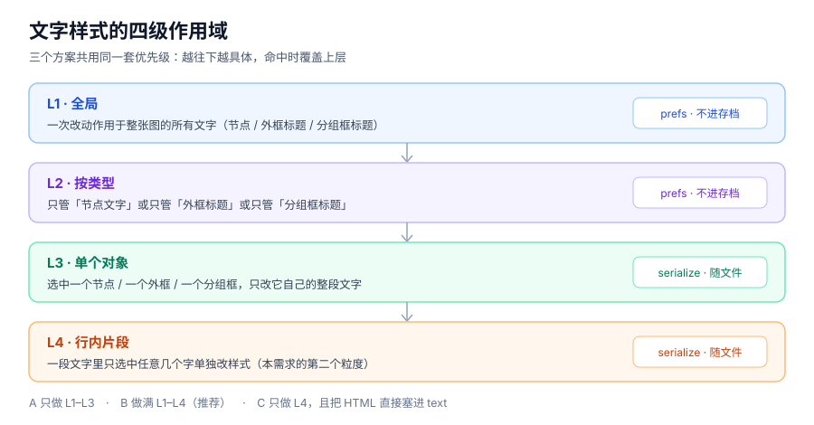
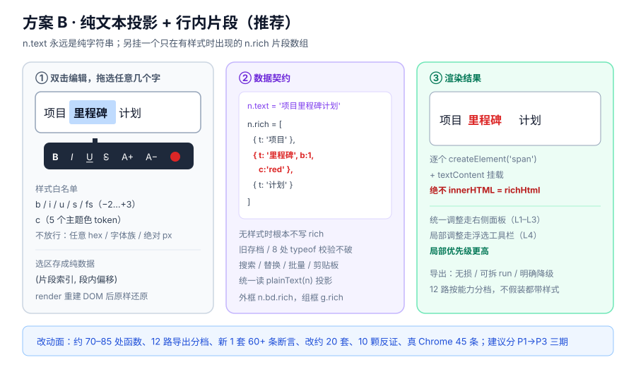
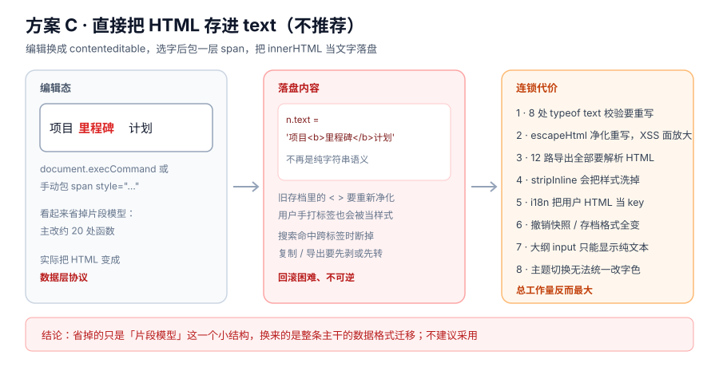

# 文字样式改造方案（评估稿 + v56–v58 落地记录）

> 状态：**2026-11-07 第 63 轮只读评估完成（当时产品零改动）；2026-11-08 第 64–65 轮已按 B 方案 P1→P3 全部落地**。第一至六节是「大版本动手之前」的选型依据，第七节是拍板结果与落地记录。
> 评估对象：`mind_map.html`（评估时 13493 行 / 774479 字节，sha1 `25fe31a6d173`）；v58 落地后 14355 行 / 822444 字节，sha1 `943c543cb7d5`；v59 后 14425 行 / 827207 字节，sha1 `115057cd7a24`；v60 后 14614 行 / 836725 字节，sha1 `2a66d0bf7abd`；v61 后 14651 行 / 839538 字节，sha1 `72bacc31ae97`。**线上仍为 v48**，本地最新为 v61。
> 配套原型图：[四级作用域](prototypes/scope.svg) · [方案 A](prototypes/option-a.svg) · [方案 B](prototypes/option-b.svg) · [方案 C](prototypes/option-c.svg)。
> 相关记录见 [优化分析报告](../优化分析报告.md) 第 63 轮评估记录与第 64–66 轮落地记录、[中文变更日志](../CHANGELOG.zh-CN.md) 与 [English changelog](../CHANGELOG.md) 顶部的 v56–v61 版本条目。
> v59 后续补充（2026-11-08 第 66 轮）：带字样的长节点曾被固定 4 行截断 —— Chrome 把 `-webkit-line-clamp` 实现成隐式 `max-height`，加斜体后尾部文字读不全。现在 `tsStyledNode()` 统一判定整段 `font` / 行内 `rich` / 全局与按类型偏好并挂 `.styled`，CSS 显式 `max-height:none`，`nodeMaxLines()` 给 24 行且 PNG / SVG / PPT 共用；无样式节点的 clamp、`⋯` 角标与默认导出字节不变。这属于显示层的体验补齐，不改变本方案的数据契约。
> 口径：第一至六节的函数名带的是**评估时**的产品行号，实现轮改动产品后行号已变，请以第七节与当前源码为准。

---

## 一、需求与结论

### 1.1 用户诉求（原文）

> 如果现在需要对外框标题、组合框标题、节点里的字体样式进行单独调整，支持粒度为可以统一调整、也支持选中部分文字单独调整，例如一个节点中有 10 个字，可支持选中其中的任意个字进行字体样式调整。请评估改造工作量和难度，以及给出具体的设计方案，方案需要有对应的原型图，方便进行方案的选择。

拆开是**两件事，难度差一个量级**：

| 粒度 | 含义 | 难度 |
| --- | --- | --- |
| 统一调整 | 全局 / 按类型 / 选中单个对象，整段文字一起改字号、字重、字形、字色 | 中低 |
| 行内调整 | 一段文字里拖选任意几个字，只改这几字的样式 | 高，是主线工程 |

### 1.2 结论

推荐 **方案 B「纯文本投影 + 行内片段」**，分 P1 → P2 → P3 三期落地；**P1 恰好等价于方案 A**，可以先做出来看效果再决定是否继续。方案 C（把 HTML 直接存进 `text`）看起来最省，实际工作量最大且不可逆，不建议。

估算基线（按本项目前几轮的实际产出折算）：

| 方案 | 主改函数 | 导出要动 | 测试影响 | 相对量级 |
| --- | --- | --- | --- | --- |
| A 只做统一调整 | 约 25–30 处 | 4 路（PNG / SVG / PPT / Word） | 新 1 套 + 改 6 套 + 5 颗反证 | ≈ v48 的 0.6 倍 |
| B 统一 + 行内片段 | 约 70–85 处 | 12 路按能力分档 | 新 1 套 60+ 条 + 改约 20 套 + 10 颗反证 + 真 Chrome 45 条 | ≈ v50 图片双份的 2–3 倍 |
| C 直接存 HTML | 表面约 20 处，实则全链路重写 | 12 路 + 净化重写 | 现存多处 `typeof text === 'string'` 校验全炸 | 最高、不可逆 |

### 1.3 现状取证：为什么「选中任意几个字」是主线工程

| 层 | 当前实现 | 对改造的影响 |
| --- | --- | --- |
| 数据 | `n.text` 是裸字符串；`serialize()` 3773 行直接落盘 | 没有地方存「第 3 到第 5 个字是红色」 |
| 净化 | `escapeHtml()` 8414 行只转义 `&`、`<`、`>`；`stripInline()` 2991 行会剥掉行内标记 | 导入端会把 `**粗体**` 和 `<b>` 洗掉；属性拼接处还有引号未转义的老缺口 |
| 渲染 | `makeEl()` 6032 行用 `innerHTML = escapeHtml(n.text)` 生成 `.node .txt`；`.txt` 521 行是 4 行 `-webkit-line-clamp` | 变成多片段后要逐个 `span` 挂载，且截断角标 `txtClipped()` 4399 行要按多字号重新量 |
| 框标题 | `.bdft` 355 行 / `.gbft` 371 行把 11.5px / 700 硬编码；`bdTitle()` 6200 行做空白压平 + 硬截 60 字 | 硬编码要先提成变量；60 字截断会把片段切坏 |
| 编辑 | `startEdit()` 9065 行创建 `<textarea>`（9091 行）；只有框标题是 `contenteditable`（6367 行） | 节点没有文本选区可用；6 条编辑入口要逐条接 |
| 选区 | `captureEditing()` 4371 行只恢复 textarea 光标；`render()` 5883 行每次全量重建 DOM；`showCtx()` 9161 行与 7192 / 12700 行都会 `removeAllRanges()` | 选区会被重建 DOM 和右键菜单清掉，是最大难点 |
| 消费端 | 搜索 / 替换 / 批量工具 / 剪贴板 / 大纲 / minimap / 统计全部直接读 `n.text` | 一处不改结构，其余全部要统一走纯文本投影 |
| 导出 | 12 路导出全部按纯文本输出（11411–11979 行） | 没有任何一路能承载行内样式，需按能力分档 |
| i18n | `tr()` 2934 行、`I18N_SKIP` 13326 行、`applyLang()` 末端无条件 `render()` | 片段文本绝不能进词表；`I18N_SKIP` 要补容器 |

一句话：**文字是贯穿全产品主干的一条裸字符串**，行内样式要穿透「数据 → 编辑与选区 → 渲染 → 搜索替换批量 → 12 路导出 → 导入回读 → i18n → 测试」整条链路。

---

## 二、三个方案与原型

### 2.1 共同骨架：四级作用域

三个方案共用同一套优先级，**越往下越具体，命中时覆盖上层**；差别只在最底下的 L4 怎么做。



L1 / L2 是偏好，进 `prefs` 不进 `serialize()`（与布局模式、语言同级）；L3 / L4 是内容，进 `serialize()`，随文件、撤销栈、复制粘贴一起走。

### 2.2 方案 A · 只做统一调整


新增「文字样式」面板，三个作用域页签；把 `.bdft` / `.gbft` 的 11.5px / 700 提成 CSS 变量，给对象加一个 `font` 覆盖字段。**优点**：无选区、无片段、不放大 XSS 面，改动集中，4 路图形导出同步一下即可。**代价**：满足不了「10 个字里只改 3 个字」。

### 2.3 方案 B · 纯文本投影 + 行内片段（推荐）



核心决策：**`n.text` 永远是纯字符串**，另挂一个只在有样式时出现的 `n.rich` 片段数组。现存 8 处以上 `typeof ...text === 'string'` 校验（2962 / 3876 / 5404 / 5535 行等）、搜索替换、复制粘贴、存档、i18n 全部不用改结构，只要统一走一个 `plainText(n)` 投影函数；只有「渲染 + 编辑 + 导出」三处理解片段。

两级入口并存：**选中对象 → 右侧面板整体改**；**双击进入编辑后拖选任意几个字 → 浮选工具栏局部改**，局部优先级更高。

### 2.4 方案 C · 直接把 HTML 存进 `text`（不推荐）



把编辑换成 `contenteditable`，选字后包 `<span style="…">`，把 `innerHTML` 当文字存下来。省掉的只是「片段模型」这一个小结构，换来的是整条主干的数据格式迁移：净化重写、8 处类型校验重写、12 路导出解析 HTML、`stripInline()` 与用户样式互相打架、i18n 把用户 HTML 当 key、旧存档回滚困难。**总工作量反而最大，且不可逆**。

---

## 三、方案 B 详细设计

### 3.1 数据契约（先定这个，其余都围绕它）

```
n.text = '项目里程碑计划'                                  // 永远是 string，旧存档不破
n.rich = [{t:'项目'}, {t:'里程碑', b:1, c:'red'}, {t:'计划'}]   // 无样式时不写这个字段
n.bd.rich = [...]                                        // 外框标题
g.rich    = [...]                                        // 分组框标题（root.groups[]）
```

约束：

- `rich` 拼接后的纯文本**必须恒等于** `text`，写入前用 `assertPlain(rich) === text` 守一道；不一致就丢弃 `rich` 退回纯文本，宁可丢样式不可丢字。
- `prefs.fontScope`（全局 / 按类型的字号字重字形字色）不进 `serialize()`；`n.font` / `n.bd.font` / `g.font` 与 `rich` 进 `serialize()`。
- `bdTitle()` 6200 行改成「对拼接后的纯文本做空白压平与 60 字截断，再按片段边界重切」，不能先切片段。
- `serialize()` 3773 行、`normalize` / 存档升级路径（4172 行附近的旧版兼容）都要认得 `rich` 且能容忍缺失。

### 3.2 样式白名单与优先级

| 键 | 含义 | 取值 | 为什么限制 |
| --- | --- | --- | --- |
| `b` / `i` / `u` / `s` | 粗 / 斜 / 下划线 / 删除线 | 0 或 1 | 布尔量最容易被 12 路导出映射 |
| `fs` | 相对字号档 | −2 到 +3 | 相对档才能跟着全局字号和主题缩放 |
| `c` | 颜色 token | 5 个主题色 token | 任意 hex 会让主题切换（字色走 `--text`）失效 |

**不放行**任意 hex、字体族、绝对 px、行高、字间距。优先级：`L4 片段 > L3 单对象 > L2 按类型 > L1 全局 > 现有 CSS 默认值`。

### 3.3 渲染与 XSS

- `makeEl()` 6032 行改成 `createElement('span') + textContent` 逐片段挂载，**绝不 `innerHTML = richHtml`**；片段样式用白名单映射到固定 class 或 `style` 白名单键。
- 顺手补 `escapeHtml()` 8414 行的引号转义缺口（当前连 `"` 和 `'` 都不转，属性拼接处已有隐患）。
- 框标题 `.bdft` / `.gbft` 同样逐片段 `textContent`，去掉硬编码的 11.5px / 700，改读 CSS 变量与 `font` 覆盖字段。
- `txtClipped()` 4399 行的量具要按「多片段、多字号」还原测量，否则 4 行 clamp 下的「文字被截断」角标会误报。
- `.node.done .txt` 666 行的删除线与 `--text-dim` 是**状态样式**，优先级要低于用户行内样式，别互相覆盖。

### 3.4 编辑与选区（最大难点）

`render()` 5883 行每次全量重建 DOM，而 `captureEditing()` 4371 行只恢复 `<textarea>` 光标，所以不能依赖浏览器 `Selection` 跨 render 存活。做法：

1. 把选区转成纯数据 `(片段索引, 段内偏移)`，即从 DOM Range 反查片段坐标，存成 `editSel`。
2. 应用样式 = **拆片段 → `pushUndo()`（必须在改动之前、带名字）→ `render()` → 按 `editSel` 还原选区**。
3. 浮选工具栏挂 `selectionchange`，位置由选区矩形算；注意 `showCtx()` 9161 行、7192 行、12700 行三处 `removeAllRanges()` 会把刚选的字清掉，要按顺序让开或显式恢复。
4. 6 条编辑入口逐条接：节点 `startEdit()` 9065 行、大纲侧栏 `<input>`、外框标题 6367 行、分组框标题 6595 行、联系说明、概要。**大纲 `<input>` 只读写 `plainText(n)`，绝不覆盖 `rich`** —— 否则在大纲里改一个字就把整段样式抹了。
5. `commitEdit()` 9131 行要把 textarea 的新纯文本与旧 `rich` 做区间 diff，尽量保住未改动片段的样式。

### 3.5 文本操作、i18n 与存储体积

- 搜索 / 替换 / 高级搜索 / 只看命中 / 批量文本工具、`subtreeToText()` 8575 行、`subtreeToMd()` 8585 行、剪贴板、统计面板、大纲、minimap 统一读 `plainText(n)`。
- 替换命中**跨片段**时按区间拆合片段，样式继承首片段；`bulkSplit` / `bulkMerge` 按片段边界切分拼接。
- `I18N_SKIP` 13326 行补上片段容器（如 `#preview`、`#c-body`），片段文本绝不进 `tr()` 2934 行；`applyLang()` 末尾无条件 `render()` 会用新词表重画，需确认片段不会被当 key 翻译。
- `UNDO_BYTES_MAX = 6MB`（3817 行）与 localStorage 4 MB 警告线要压测：片段数组让快照膨胀，必要时对 `rich` 做「连续同样式片段合并」的归一化再入栈。

### 3.6 12 路导出分档（按能力落地，别假装都能带样式）

| 档 | 格式（入口行号） | 做法 |
| --- | --- | --- |
| 无损 | JSON 11411 · 独立网页 11935 / 11979 · 打印 PDF | 同一份 `serialize()` / DOM，天然保留，不用改 |
| 可拆 run | Word 11497 · SVG 11879 · PPT 11509 / 11552 · PNG 11577 | 单 `<w:r>` → 多 `<w:r>`；`<tspan>` 加属性；`<a:r>` 拆段；canvas 逐片段 `measureText + fillText` |
| 明确降级并提示 | Markdown 11448 · OPML 11492 · XMind 11557 · Excel 11502 · 复制文本 | 属性 / `title` 无结构；导出前提示「此格式不保留行内样式」，绝不静默丢 |

Markdown 就算写成 `**里程碑**`，回读也会被 `stripInline()` 2991 行洗掉，所以**不要**用 Markdown 当片段的持久化通道。

### 3.7 导入回读

Markdown / OPML / XMind / Word 大纲 / 粘贴文本 / 箭头流程解析写回 `n.text` 时一律不产生 `rich`；只有独立网页、JSON、工作区导入会带回片段。导入端要保留 `stripInline()` 的净化职责，但**不能再误伤**用户手打的合法文字。

---

## 四、全链路接触点清单

| 层 | 函数 / 模块（行号） | 必改内容 | 高风险点 |
| --- | --- | --- | --- |
| 数据 | `serialize()` 3773 · `bdTitle()` 6200 · 存档升级 4172 | 认得 `rich`、容忍缺失、纯文本恒等断言 | 旧存档兼容、撤销快照膨胀 |
| 编辑与选区 | `startEdit()` 9065 · `commitEdit()` 9131 · `captureEditing()` 4371 · 6371 · `showCtx()` 9161 · 7192 · 12700 | 选区转纯数据、拆合片段、6 条入口 | XSS、选区丢失、右键清选区 |
| 渲染与样式 | `makeEl()` 6032 · `render()` 5883 · `txtClipped()` 4399 · `.txt` 521 · `.bdft` 355 · `.gbft` 371 | 逐片段 `textContent`、CSS 变量、量具重算 | 引号未转义、主题色覆盖、clamp 误报 |
| 交互与快捷键 | 样式面板 · 浮选工具栏 · 快捷键唯一源 `SHORTCUTS` · 浮层三要素 | 面板与工具栏共存、Esc 可关、16 张浮层同步 | 与现有浮层 z-index / 抽屉遮罩 19 冲突 |
| 导出 | 11411–11979 全部 12 路 | 按三档实现，降级要提示 | 导出降级、PNG 逐片段测量偏差 |
| 导入回读 | `stripInline()` 2991 · 粘贴 / 大纲 / XMind 解析 | 不误伤、不伪造片段 | 用户手打标记被洗掉 |
| i18n | `tr()` 2934 · `I18N_SKIP` 13326 · `applyLang()` | 补 SKIP、片段不进词表 | 用户内容被当 key 翻译 |
| 测试与反证 | `_test/runall.py`（49 套 / 3770 条）· 44 份反证 · 34 组真 Chrome 探针 | 新 1 套 60+ 条、改约 20 套静态守卫、10 颗反证 | 断言与守卫同源造成假绿；真 Chrome 才有真实选区 |

---

## 五、工作量与分期

### 5.1 估算口径

按本项目已交付轮次折算：v48（框几何重构，已发布）约 30 处函数 / 1 套专项 / 6 颗反证；v50（图片双份 + IndexedDB）约 45 处 / 1 套 / 10 颗反证 / 真 Chrome 48 条。方案 B 的接触点比 v50 更多，且横跨 12 路导出与选区，取 2–3 倍是保守值。每期仍严格走项目四步验收：**jsdom 专项 → 反证（拆坏产品、同批用例变红、还原并 sha1 核对）→ 全量回归 0 失败 → 真 Chrome 补 jsdom 量不到的真实选区 / 排版 / 命中**。

### 5.2 分期表

| 期 | 范围 | 量级 | 出口条件 |
| --- | --- | --- | --- |
| P1（≈ 方案 A） | 三类对象统一调整 + 4 路图形导出 | 约 30 处、新 1 套 + 改 6 套、5 颗反证 | 全局 / 按类型 / 单对象三档可切换，主题切换不串色 |
| P2（主体） | 节点文字行内片段 + 无损 / 可拆 run 导出 | 约 50 处、改约 20 套既有断言 | 拖选任意几个字改样式，render 后选区可还原，Word / SVG / PPT / PNG 带样式 |
| P3（收尾） | 框标题 / 联系说明行内 + 降级导出与导入回读 | 约 20 处、真 Chrome 45 条 + 10 颗反证 | 降级格式有提示，导入不误伤，旧存档全绿 |

### 5.3 每期必做的文档同步

文档七件套（CHANGELOG 中英、README 中英规模数字、USAGE 中英、优化分析报告）、`_test/_shot.py both` 重生成 18 张双语配图、`_mdcheck.py` 与 `_i18n_build.py --check`、发布副本同步、工作记忆更新。**线上发布必须等用户新一轮明确说「发布」**。

---

## 六、风险与边界

### 6.1 四个硬骨头

1. **选区与全量 `render()` 的冲突**：DOM 每轮重建，浏览器 `Selection` 不存活；必须把选区数据化并显式还原，真 Chrome 才能验。
2. **XSS 白名单**：`escapeHtml()` 目前只转三个字符，片段渲染一旦走 `innerHTML` 就等于开了口子；必须 `textContent` + 白名单。
3. **12 路导出分档**：能力差异大，最容易出现的错是「静默丢样式」；降级必须可见。
4. **跨片段文本操作 + 撤销体积**：搜索替换跨片段、批量拆分合并、`UNDO_BYTES_MAX` 6MB 与 localStorage 4 MB 警告线都要压测。

### 6.2 明确不做的

- 不做富文本编辑器（没有段落、列表、图片混排、撤销栈分帧）。
- 不放行任意颜色 / 字体族 / 绝对 px，避免主题与导出映射失控。
- 不用 Markdown 的 `**` 当持久化通道（`stripInline()` 会洗掉）。
- 不改 `localStorage` 键 `mindmap-studio-v1`，不换 `STORE_KEY` 口径。
- 本轮评估**不改产品代码**、不跑四步验收（那是实现轮的事）。

---

## 七、拍板结果与落地记录

用户已选择 **方案 B「纯文本投影 + 行内片段」**，要求按 **P1 → P2 → P3** 顺序依次完成。三期均已落地并通过四步验收：

| 期 | 版本 | 交付 | 验收 |
| --- | --- | --- | --- |
| P1 | v56 | 四级作用域统一调整、样式白名单、第 17 张浮层、五路导出同步 | `v56.js` 121 条 / 10 颗反证 / 全量 50 套 3891 条 / 真 Chrome 36 条 |
| P2 | v57 | 节点文字行内片段、浮选工具栏、选区数据化、Word / PPT / SVG / PNG 拆 run | `v57.js` 72 条 / 12 颗反证 / 全量 51 套 3964 条 / 真 Chrome 33 条 |
| P3 | v58 | 框标题 / 分组框标题 / 联系说明行内、降级可见、导入回读、I18N_SKIP 收口 | `v58.js` 73 条 / 13 颗反证 / 全量 52 套 4037 条 / 真 Chrome 36 条 |

最终产品 **14355 行 / 822444 字节**（sha1 `943c543cb7d5`），EN 词表 1074 条 + 9 HTML，反证脚本 50 份、真 Chrome 探针 37 组。三期的实施与「评估阶段不改代码」的约定互不冲突：评估只读、实现另起轮次。**线上仍为 v48** —— 按约定本轮不发布，需要上线请明确说「发布」。

